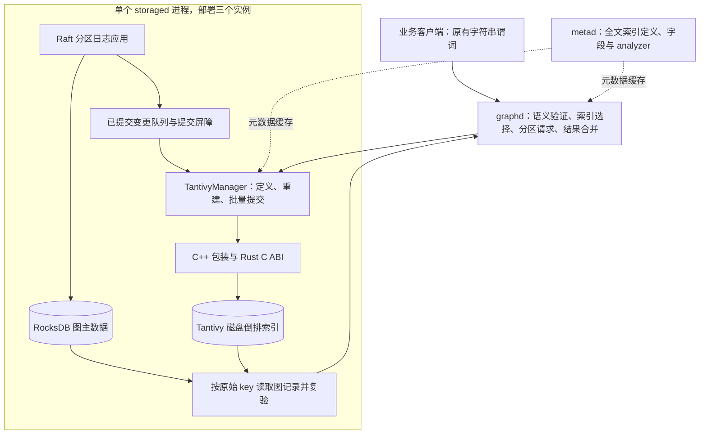

# NebulaGraph 内置 Tantivy 全文索引原型

> 状态快照：2026-11-05。单机三 storage、20 分区、3 副本已有 93/93 项不重复的端到端检查通过记录：主演示 39 项、生命周期 23 项、原生语法 18 项、TopK 10 项、立即重建 3 项。Rust 检索引擎另有 9 项真实磁盘测试通过，C++ 桥接已通过静态库集成测试。百万数据同集群下推开关对照已完成；最新 TopK、生命周期和立即重建已使用新报告复验；主演示 39 项和原生语法 18 项也已最终复验，全部检查按独立案例计数，未重复累计复验。百万 ES 与新版原生查询已有绝对实测，但完整命中集合和索引结构/复制策略不同，尚不满足等价收益对照条件；亿级导入与商业可靠性验收未完成。

## 目标与范围

项目以 NebulaGraph 3.6 分支为基线，把 Tantivy 嵌入普通 `storaged` 进程，移除本方案对独立 Listener 与 ES 服务的依赖。业务查询直接使用属性 `CONTAINS`、`STARTS WITH`、`ENDS WITH`，由规划器识别可用全文索引并下推，保留原始表达式作结果复验。

本次已验证单机三个 storage 进程、20 分区、3 副本。每个分区分配 12 条人工记录，以覆盖全部分区的召回；实际拓扑记录在主演示报告中。这是多进程副本验证，不能等同于三个物理故障域。可靠性不是本轮验收重点，但原型必须在索引不可用时显式失败，不能把缺索引伪装成空结果。

## 架构



图中 Graph 与 Storage 端接入已在主演示中运行，普通属性查询的执行计划确认使用 Tantivy。每个 storage 在本机数据目录中持有独立 RocksDB 与 Tantivy 索引，Tantivy 自身不提供分布式协调。[Tantivy 官方说明](https://github.com/quickwit-oss/tantivy)

## 索引组织

一个逻辑全文索引在每个 storage 进程内对应一个 Tantivy 实例，覆盖本机持有的相关分区。这样按逻辑索引分配 writer，避免对每个分区副本单独分配 writer 内存。

| 字段 | 用途 |
| --- | --- |
| 完整二进制图记录 key | 唯一文档标识，支持顶点、边和二进制 VID |
| key 的前四字节 | 分区与记录类型的倒排过滤条件 |
| 原始文本字段 | 保存原值，供短串匹配及候选精确复验 |
| 语言分词字段 | 词项、短语、布尔查询与本地 BM25 分数 |
| Unicode trigram 字段 | 缩小 substring 查询候选集，保持大小写敏感 |

磁盘格式固定 Tantivy 0.25.0，依赖锁定在 `Cargo.lock`。C++ 通过长度显式的 C ABI 传递任意二进制 key，Rust 以 UTF-8 解析文本。`standard` 使用英文词和中文单字，`keyword` 使用整串，`jieba` 使用真实中文词典分词。未知 analyzer 明确报错。名称相同不表示分词结果与 ES 完全一致。

Tantivy 文档存储采用 LZ4。构建禁用 Tantivy 的 columnar-zstd 特性，并将 Jieba 字典嵌入依赖的默认压缩限定为 DEFLATE，避免与 Nebula 自带的静态 zstd 库发生重复符号冲突。部署机器只需编译后的服务，不需要安装 Rust 工具链。

## 写入与可见性

1. Raft 日志应用成功后，RocksDB 已接受图记录变更。
2. Part 回调将已提交变更送入带容量背压的队列。背压发生在 Raft 提交路径上，因此必须测量对图写入延迟的影响。配置容量不包含已取出的处理批次；单个超大批次及清理控制事件允许例外，不能把配置值当作严格总内存上限。
3. storage 后台线程维护索引定义，批量执行 upsert/delete，再提交 Tantivy 并刷新 reader。
4. 查询获取已提交队列序号并等待对应提交屏障，然后执行候选检索。

Tantivy 的提交与 RocksDB 的提交不是一个原子事务。C++ 包装的 `commit()` 完成 Tantivy 持久化并刷新本实例 reader，关闭实例不会自动提交未提交操作。原型重启后从 RocksDB 全量重建，覆盖内存队列丢失，不宣称已实现精确 WAL 断点续建。

Manager 已加入同名索引定义变化检测并重建。队列事件回读当前 RocksDB 权威值，避免旧 PUT 或 DELETE 覆盖较新的主数据。初始回填每 100,000 条提交一次，控制未提交删除缓冲，全部回填完成前不宣布 ready。这些接入修正仍需端到端并发测试确认。

索引重建、查询与关闭目录使用生命周期互斥锁；同名定义替换前先关闭旧 writer，再删除派生目录。显式重建可以关闭此前失败的实例、删除派生索引目录并重新打开回填。分区清理和快照重置在 RocksDB 清理成功后通知 manager 重建，避免绕过常规变更日志后残留旧索引。该控制事件不等待队列容量，避免在已有分区锁内等待回填造成死锁；同一批次内同一索引的重建事件会合并。

最新 `CLEAR SPACE` 在主数据清理返回后调用同步重建，等候相应全文索引 ready 后才返回成功；若重建失败会返回错误，但已经完成的主数据清空不会回滚。显式重建先向 Meta 读取权威定义快照，等待本地定义出现、队列屏障及 ready 状态，并在返回前复核定义；本地缓存暂时为空不能被当成重建成功。期间定义被删除或替换、索引不可用、进程停止或超过一小时等待期限时返回失败。权威快照确实无全文索引时允许成功。

后台线程遇到未恢复异常时，将索引标为不可用、停止 worker 并唤醒等待者，不发布未完成批次的提交序号；这类失败需要重启该 storage 后全量重建。新版生命周期 23 项复验通过既有数据自动回填、三 storage 显式重建、删除后同名重建、CLEAR SPACE 后空集合与重插。立即重建另有 3 项通过：三个 storage 任务 FINISHED 后，首次直连 storage 候选读取共 200 条完整记录，重试次数为 0。失败打开恢复的故障注入及快照集成验收尚未完成。

## 无感查询与精确语义

```ngql
LOOKUP ON article
WHERE article.body CONTAINS "数据库"
YIELD id(vertex) AS id;
```

以上形态已在主演示通过，另有对应 `MATCH` 查询及 Tantivy 执行计划证据。主演示还覆盖大小写区别、单字、词内子串、字面正则字符、空串、前后缀、边、多字段及残余 `AND` 条件。下推选择的是正向字符串谓词，不应把无法安全下推的 `NOT` 或混合 `OR` 条件硬改为索引命中。

substring 检索将分区过滤与 trigram 候选条件组合，然后逐条对保存的原始文本执行大小写敏感 `contains`、`starts_with`、`ends_with`。命中数限制在原文和 key 前缀验证之后生效，避免先截断候选造成漏查。短于三个 Unicode 字符或空串时使用分区范围内候选扫描，保证语义但不保证加速。

Graph/Storage 继续读取权威图记录并计算原始表达式，过滤已删除记录和不再满足谓词的候选；空值语义由原始表达式决定。当前全文索引 DDL 不允许依赖启用 TTL 列的 schema，尚未验收后续 TTL 配置变化。这种复验可以去除多余候选，但不能补回错误同步造成的缺失候选，因此索引更新顺序和提交屏障仍然必要。

全文 Query 模式通过 `TEXT_SEARCH` 提供词法检索入口；普通属性谓词无需调用该函数。该模式保留 Tantivy 的查询语法树，并通过兼容层实现以下已通过桥接测试的模式：

| 模式 | 示例 | 当前语义 |
| --- | --- | --- |
| 词项、短语、布尔、字段限定 | `quick`、`"quick brown"`、`quick AND fox`、`text:quick` | 使用配置的 analyzer |
| 前缀与通配 | `Da*`、`*b*`、`qu?ck` | 对完整索引词项匹配；standard/jieba 规范化字母大小写 |
| 正则 | `/qu(i\|a)ck/` | 对完整索引词项匹配；正则大小写保持原样 |
| 模糊词项 | `quik~`、`quik~1`、`quick~0` | 支持 0、1、2 次编辑距离，省略距离时为 2 |
| 加权与范围 | `quick^2`、`[blue TO brown]` | 保留加权及闭区间词项范围 |

特殊查询可放入布尔组或字段限定表达式，非法字段和不支持的语法明确报错。正则支持 Tantivy 的正则子集，不支持 Lucene 的交集、补集或数字区间等扩展。模糊输入必须经 analyzer 产生一个词项。精确词项和短语使用本地 BM25；通配、正则和模糊节点使用 Tantivy 自动机查询评分。分区过滤项贡献零分，桥接测试验证的是同一索引 reader 中不会额外引入分区过滤项的评分；这不保证独立 storage 的统计相同。Graph 按各分区实际返回的分数合并排序，未实现全局 IDF 校准。即使三个副本逻辑文本一致，分段、删除文档统计及合并进度也可能导致 BM25 分值不同，不能据复制拓扑声称全局评分一致。以上不等于完全兼容 ES query DSL、全部 Lucene 语法、ES 分值或 IK 分词。

主演示已验证词项、中英文短语、显式布尔组合、多字段、边的 `TEXT_SEARCH`，以及分数输出和全局 OFFSET/LIMIT。独立原生查询语法回归 18/18 通过，覆盖前缀、通配、正则、模糊、邻近短语、加权、范围和语法错误；正常查询均比较完整 VID 集合，尚未证明与 ES 的评分数值或排序完全一致。逐项状态见 [fulltext-compatibility.md](fulltext-compatibility.md)。

## 有界候选与全局分页

最新接入仅对满足条件的 `TEXT_SEARCH` 顶点查询下推 `K = offset + count`：VID 为 FIXED_STRING，单一索引上下文、有限正数 LIMIT，无额外过滤、统计列或自定义排序。每个分区先按分数降序、解码 VID 升序返回至多 K 条，Graph 再合并、去重和全局分页。普通字符串谓词、INT64 VID、边及不满足条件的查询继续使用完整命中路径。

Storage 回查主数据，保留成功读取的记录供后续返回；若有限候选中出现已删除 key、非规范填充的 VID、重复解码 VID 或零分边界，则回退为该分区的完整候选，在 Graph 相同排序规则下选出 K 个有效唯一 VID。读错误、非法 key 或非有限分数显式失败。这些保护避免先截断后过滤造成漏页。

有界收集不是全查询仅用 K 条内存：桥接按 segment 收集，Graph 合并多个分区，安全回退仍可能读取全部命中。它也不是 WAND 式跳过候选的实现，不能由 LIMIT 推断只扫描 K 个文档。新接入已有独立 10 项集群检查通过：650 条人工记录的常量分数参考、六种分页（含空页）、显式排序保留完整路径、BM25 页面与当次完整分数/VID 排序一致，以及 CONTAINS 仍为完整候选。百万普通 MATCH 开关对照先于这次接入，不作为 TopK 的收益证据。新版原生 TEXT_SEARCH 已单独完成 12,000 请求的单并发及四并发测量，分别为 36.2224 和 52.7110 QPS；两轮是绝对观测，不由旧版不同采样计算 TopK 加速比。

## 已有证据与待验收事项

| 层次 | 状态 | 证据或验收要求 |
| --- | --- | --- |
| Rust 检索桥接 | 已验证 | 9 个真实磁盘测试，持久化、更新删除、查询语法、分区评分和 analyzer |
| C++ / Rust ABI | 已验证 | C++14 严格编译与真实静态库集成测试 |
| 三 storage 部署 | 已验证 | 主演示记录三进程、20 分区、3 副本拓扑 |
| 无感下推与数据变更 | 主演示通过 | 39/39 项含 MATCH/LOOKUP、创建索引、更新删除和计划证据 |
| 原生全文功能对齐 | 主要模式端到端通过 | 主演示和独立 18 例语法回归通过；非全部 ES/Lucene 方言兼容 |
| 索引生命周期 | 新版 23 项复验通过 | 自动回填、显式 REBUILD、DROP 后同名重建、CLEAR SPACE 后重插，含 INT64 VID；快照与故障恢复待验收 |
| 有限候选与立即重建 | 10 + 3 项通过 | 650 条分页数据及 200 条立即重建数据；均为正确性证据 |
| 公开大数据集 | 已选择 | MS MARCO passage v2，官方 138,364,198 条 |
| 百万数据同集群对照 | 已实测 | 128 字符投影；同 MATCH 并发 1 下推开关 QPS 比值 112.883，非 ES 加速比；条件见性能报告 |
| 五百万真实记录 | 已实测 | SHOW STATS 为 5,000,000 顶点/0 边，完整谓词集合一致，单/四并发分别 3.9051/11.6882 QPS |
| 数据库亿级导入 | 未完成 | 实际独立 VID 数、三副本落盘和成功日志 |
| 新版原生 TEXT_SEARCH | 已实测 | 单并发与动态四并发各 12,000 次、0 失败；单列于性能报告 |
| ES 完整服务栈 | 已有绝对实测，语义不等价 | 三项原生查询差集为 54/77/2；索引结构、全文副本策略不同，不计算速度或降配比例 |

桥接日志：`task-logs/tantivy-bridge/`。数据与基准方法见 [benchmark-data.md](benchmark-data.md)。来源规模与数据库实测规模必须分开报告。

最新桥接回归记录为 `query-compat-test.log`（9 passed，0 failed）；对应发布版静态库构建记录为 `query-compat-release.log`。`zstd-symbol-check.log` 为空表示发布版 Rust 静态库未定义额外的 `ZSTD_`、`HUF_`、`FSE_` 符号。构建时间属于工程验证数据，不是产品吞吐或延迟数据。

主演示报告为 `task-logs/tantivy-demo/verified-final/report.json`，图空间为 `tantivy_demo_v3`，记录 39 项检查全部通过及全部 20 个分区的拓扑。生命周期新版报告 `task-logs/tantivy-lifecycle/post-topk/report.json` 记录 23 项通过；原生查询报告 `task-logs/tantivy-benchmark/regression-tantivy-final/regression.json` 记录 18 项通过。新增 TopK 报告 `task-logs/tantivy-topk/verified-v2/report.json` 记录 10 项通过，立即重建报告 `task-logs/tantivy-rebuild-immediate/verified-v2/report.json` 记录 3 项通过。五组共 93 项不重复的小规模语义检查，生命周期复验未重复计数，运行耗时不能作为查询延迟或建索引吞吐基准。

## 落地路线

比赛原型已证明内置路径可运行，已有字符串谓词能够选择内置索引，主演示中的数据变更后结果正确，主要扩展语法与基础生命周期已有通过记录。百万真实投影数据已有绝对吞吐、延迟、资源及同集群开关对照，详见 [benchmark-report.md](benchmark-report.md)。五百万阶段已完成，当前保留 `ft_bench_5m`；主演示空间已恢复并通过最终复验。下一步定位两引擎语义差异，建立等价 ES 对照并完善兼容边界。一亿阶段未通过本机容量门槛，五百万绝对观测不作为亿级外推或百万到五百万扩展比。

试点阶段需要覆盖缺失候选检测、故障注入、增量恢复、分区迁移、磁盘满、索引损坏重建与备份恢复。商业阶段还需要完成跨分区评分策略、全量原生功能对齐、升级兼容、容量控制和长期稳定性压测。
