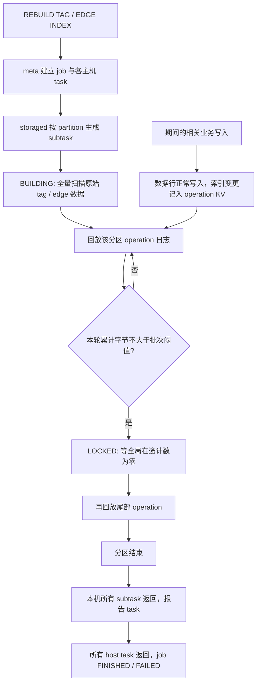

# 索引重建长期 RUNNING：根因分析

分析基线：`cccxgit/nebula` 的 `nebula-index` 分支，提交 `de9b3ed800a6627d9845e9289b6bbc5b6faf460a`。分析日期：2026-10-10。本文引用的源码行号是该提交的原始行号，不包含本次新增的观测日志。

## 1. 已定位的代码缺陷与生产归因边界

**本分支的增量索引回放存在确定的批次重复提交缺陷，足以把几十万条单分区积压放大为超过两天的执行时间。** 点索引与边索引共用此路径。缺陷在 `src/storage/admin/RebuildIndexTask.cpp` 的 `buildIndexOnOperations()` 与 `writeOperation()` 配合处。

当前没有收到生产版本对照、job/task 明细、索引定义、运行参数和 storaged 日志。因此需要区分：

- **可以证明**：本分支存在该缺陷、满足什么条件触发、它怎样导致极慢推进、怎样量化两天的下界。
- **还不能证明**：那一次生产事故必定在此处等待，或者该缺陷是生产唯一瓶颈。生产归因必须与同一 job/host/partition 的阶段和行为匹配。

其他可解释长期 RUNNING 的路径包括全量扫描/底层写入阻塞、全局在途计数不归零、某个 host 的任务结果未上报。它们的区分方法见第 7 节与 [作业状态详解](04-job-lifecycle.md)。

本次没有修复代码。业务源码只有增加 `INDEX_DIAG` 日志和用于输出日志的计数、计时；完整差异保存在 `observation-only.patch`。实验配置变更只作用于本机独立测试实例。

## 2. 一次重建实际包含什么



`Building index successful` 只表示 **全量阶段**结束，其后紧跟 `Processing operation logs`。只要一个分区的回放没有返回，本机 task 就不能完成；一个 host task 未完成，meta job 就可以一直 RUNNING。这里没有按两天或七天自动终止 RUNNING 重建的执行超时。

源码入口：`RebuildIndexTask.cpp:93–131`，`AdminTaskManager.cpp:291–324`，`JobManager.cpp:510–529、689–702`。详细点边索引结构与写入机制见 [02-index-mechanism.md](02-index-mechanism.md)。

## 3. 缺陷的最短因果链

回放核心控制流可概括为以下**解释用伪代码**，不是修复代码：

```text
每次创建一个 operation 迭代器：
    batch = 新 BatchHolder
    对该迭代器的每条 operation：
        batch 追加正式索引 put/remove
        batch 追加删除该 operation key
        如果 batch.size > B：
            编码并提交整个 batch，等待回调
            # 原实现返回后仍保留 batch 及全部历史 entries
    编码并提交整个 batch，等待回调
    用仍然累计的 batch.size 判断是否转 LOCKED
```

1. `BatchHolder` 只在每轮迭代器开始时创建（基线 155 行）。
2. 超过 `rebuild_index_batch_size` 后提交（174–179 行）。
3. `writeOperation()` 读 `getBatch()` 的 const 引用，生成新字符串并提交；没有清空原 batch（258–276 行）。
4. 下一条 operation 继续加入同一个 batch，仍超过阈值，于是又提交整个历史前缀。
5. 同一轮累计序列化和提交量变为 **O(N²)**；内存保留量为 O(N)。尾部还会再提交一次完整 batch。
6. 当累计 `batch.size > rebuild_index_part_rate_limit`，`RateLimiter::consume()` 每次固定等待 1 秒（`src/kvstore/RateLimiter.h:40–49`）。此后每推进一条 operation 至少多等一秒，还要加编码、复制、WAL 和 RocksDB 成本。

真实数据层删除已回放的 operation，不能清空 C++ vector；`std::move(encoded)` 移走的是本次编码后的字符串，不能清空原 holder。RocksDB 当前迭代器仍有稳定视图，所以已删除早期 operation 也不改变它必须走完本轮快照的事实。

**这不是有限数据必然永不退出的死循环。** 停止后续写入、底层回调正常返回且没有错误或取消退出时，当前大轮最终会结束，再创建的新迭代器可为空；若共享在途计数也能归零，便可完成。但“大轮最终结束”本身可能在两天以后。若仍持续写入，期间生成的日志进入下一轮，收敛可能更困难。

对照：点、边全量阶段的批量写入在提交后会 `data.clear()` 并将 `batchSize=0`，并不具有这个累计重发行为。

## 4. 为什么积压不需要特别大的业务量

全量扫描期间没有并行消费者回放 operation；该阶段越久，积压越多。状态按 `(space, partition)` 管理，所以该分区内其他索引的写入也可能进入同一个 operation 前缀。覆盖/更新可能产生“删除旧索引＋写入新索引”，多个索引或地理索引还能进一步增加 operation 数。

因此下文的 N 指 **单分区、单轮迭代器里的 operation KV 数**，不是整库节点数、业务请求数，也不能直接把多个分区的条数相加。

设无 TTL 的一次 modify，其完整索引键长 K，则回放 holder 每条增加：

```text
d = K（正式索引 put）+ (16 + K)（删除 operation key）= 2K + 16 字节
```

VID=8、单列 `INT NOT NULL` 时，点索引 K=24、d=64；边索引 K=40、d=96。字符串、复合字段、nullable bitmap、TTL 都会改变尺寸。计算应使用实际 schema。

## 5. “超过两天”的可校验下界

参数必须读运行实例，不能混淆两套缺省：

| 来源 | 批次阈值 B | 限速参数/突发额度 R |
|---|---:|---:|
| `StorageFlags.cpp` 编译缺省 | 128 KiB | 512 KiB/s，burst 512 KiB |
| `.default` / `.production` 配置模板 | 1 MiB | 4 MiB/s，burst 4 MiB |

第一条触发重复提交的序号是 `floor(B/d)+1`。第一条既发生提交又超过 R 的序号是 `u=max(floor(B/d)+1, floor(R/d)+1)`。当前轮固定一秒等待次数至少为：

```text
max(0, N-u+1) + (N*d > R ? 1 : 0)
```

最后一项来自循环结束后的完整 batch 再提交。

| 参数与输入条件 | 仅固定一秒等待 | 累计编码字节，含重复内容 |
|---|---:|---:|
| 编译缺省；点 K=24；单轮 200,000 条 modify | 191,809 秒，2.220 天 | 约 1.64 TB |
| 配置模板；点 K=24；单轮 250,000 条 modify | 184,465 秒，2.135 天 | 约 2.55 TB |
| 配置模板；边 K=40；单轮 250,000 条 modify | 206,311 秒，2.388 天 | 约 3.56 TB |

这些是源码公式外推，**不是本次实际运行了两天**。累计编码量也不是最终磁盘占用、实际网络流量或压缩后的 WAL 大小。小规模实际序列化结果和完整公式相互校验，详见 [03-rebuild-code-audit.md](03-rebuild-code-audit.md) 与 [原始 CSV](audit/amplification.csv)。

## 6. 已完成的源码级实验

实验自动从原始 HEAD 抽取完整回放方法、writeOperation、BatchHolder 和真正的 batch 编码器，运行时以内存 KV 与立即成功回调替代 RocksDB/Raft，限速在这部分只计数。另一个程序直接执行原始 RateLimiter 的超额分支，测量真实等待。

- 2,200 条点 modify，仅约 140.8 KB 回放 payload，生成 155 次 append、26,662,183 B 编码；越阈值后每次只多两条底层 entry，却再次提交已有数千 entry。
- 8,250 条点 modify，最终 8,250 个索引键，累计实际生成 2,619,607,483 B 编码，59 次调用超过 512 KiB。
- 原始 RateLimiter 的两个超额分支分别实测约 1000.09 ms、1000.06 ms。
- 独立的全局计数实验：operation 已空，但另一个作用域令共享计数为 1，重建仍等待；设置 cancel 不解阻，释放计数后才退出。该实验没有真实业务并发，也没有证明生产在这里等待。

全部抽取片段、程序、编译命令、计数、断言和限制见 [03 报告](03-rebuild-code-audit.md)。真实三进程服务的对照实验单列在 [05-live-reproduction.md](05-live-reproduction.md)，其原始结果以该报告及 `live/` 目录为准。

### 6.1 真实服务对照已经完成

三进程实际服务的三组实验全部通过，业务逻辑保持原样：

- 点索引，128 KiB / 512 KiB：无并发 18.047 s，新增 96 条后 82.289 s。
- 边索引，同组参数：无并发 18.059 s，新增 96 条后 82.280 s。
- 点索引，模板 1 MiB / 4 MiB：无并发 4.017 s，新增 576 条后 315.063 s。

分别实际观察到 34、34、68 次超过 burst 的一秒等待；回放条数与输入完全相符，三次问题组均自然 FINISHED，新增 LOOKUP 计数正确。点组阶段计时还确认额外约 64 秒发生在回放，LOCKED 排空和上报很快。数据、全量 nGQL、日志与原始事件见 [05 真实复现](05-live-reproduction.md)。这些是本机小规模实测；两天仍是明确标注的源码下界推导。

## 7. 怎样与生产事故闭环

建议收集并保留时间戳，按顺序关联：

1. 实际生产提交号及相应函数，与本次分析基线是否一致。
2. `SHOW JOB <id>` 的 RUNNING host/task，具体尚未完成的分区。
3. 同一分区是否已经进入 `Processing operation logs`。
4. 生效 B/R、索引字段定义、VID、nullable/TTL，以及期间写入方式和速率。
5. 相邻回放提交是否呈现“entries 每次增加 2，但 batch 总量单调增长；超过 R 后 limit_ms 约 1000”的指纹。

若第 3、5 项吻合，便能把这次生产的慢阶段与本缺陷直接连接。若停在 `locked_wait` 且 `on_flying` 不归零，优先查共享计数和相关写作用域；若 storage task 已结束，优先查其完成上报和其他 host task。

`STOP JOB` 只设置协作取消标志，回放内层与 LOCKED 等待没有检查该标志，因此“STOP 成功但仍在工作”不能排除此缺陷。`SHOW INDEX STATUS` 也只是 job 摘要，不能取代阶段、进度和上报证据。完整只读采集命令、状态陷阱与重启分支见 [04-job-lifecycle.md](04-job-lifecycle.md)。

本次调查输出的是解释、观测与复现材料，没有修改批次清理、限速、锁定条件、取消逻辑或作业状态逻辑，也没有提交或推送任何修复。
