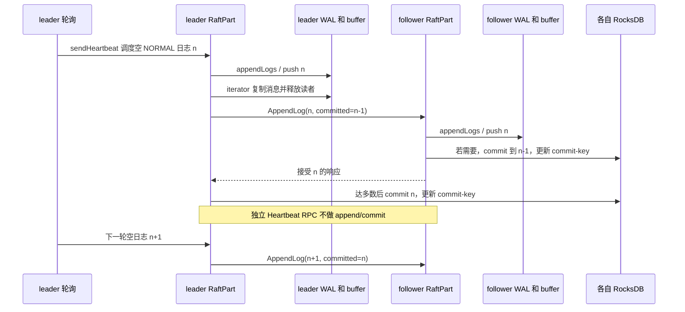

# 空闲分片仍持续产生 WAL 的完整代码路径

本文沿当前工作区的实际调用关系解释：空间如何变成本机对象、为什么没有业务请求仍然追加日志、日志如何同时进入三个副本、读者何时退出，以及这些行为如何连接到内存长期上升。所有判断来自当前 `3.6-memory` 源码；仅 `AtomicLogBuffer.cpp` 有本任务增加的观测语句，业务条件没有修复。文中行号按当前含观测代码的工作区计算。

核心事实是：**每个本地分片副本拥有独立 WAL 和内存缓冲；运行中的 leader 周期性调用 `sendHeartbeat()`，只要当时没有正在复制的日志，就异步追加一条空消息。空消息通过正常 Raft 复制落入 leader 和 follower 的 WAL 与缓冲。空消息占用逻辑字节和固定 Record 槽位；空间不再被查询不会销毁这些对象。** 这与“只有业务写才会写 WAL”或“只有 leader 会增长”都不同。

本文不把这一机制直接等同于全部 RSS 增量。`Part::commitLogs()` 还会更新 RocksDB 的 commit-key，其 memtable 是另一条实际写入路径；allocator、缓存和启动分配也要由实验分别观测。

## 1. 空间、分片、副本在本机分别对应什么

`SpacePartInfo` 保存 `parts_`（`PartitionID -> shared_ptr<Part>`）和 `engines_`（`unique_ptr<KVEngine>` 数组），见 [NebulaStore.h 的对象容器](https://github.com/cccxgit/nebula/blob/de9b3ed800a6627d9845e9289b6bbc5b6faf460a/src/kvstore/NebulaStore.h#L30)。一个空间在每个已配置 data path 上有一个 RocksEngine；本空间的本地分片分配给其中一个引擎。因此，**RocksDB 实例粒度通常是空间×本机数据路径，Raft WAL/AtomicLogBuffer 粒度是本地分片副本**，不能把两种数量混用。

假设只有 3 个普通 storage 实例、50 个空间、每空间 20 分片、每分片 3 副本，且全部分配完成、没有额外 learner，则：

| 对象 | 整个集群 | 每个 storage（各只有一个 data path） |
| --- | ---: | ---: |
| 逻辑 Raft 分组 | 50×20 = 1000 | 参与全部 1000 组 |
| 分片副本 / Part / FileBasedWal / AtomicLogBuffer | 1000×3 = 3000 | 1000 |
| RocksEngine / RocksDB | 50×3 = 150 | 50 |
| 当选 leader 的分片 | 1000 | 只占一部分，通常约 1/3，实际看选举结果 |

“每个实例约有三分之一 leader”并不意味着它只有三分之一 WAL：剩余分片以 follower 身份接收日志，仍有自己的 WAL、缓冲和 commit-key。若 storage 数量超过 3，某实例的本地副本数取决于分片分配，不再自动等于全部 1000 分片。

## 2. 元信息变更如何创建常驻对象

集群启动和在线新建空间有两个入口，最终都进入 `addSpace/addPart`。

**进程启动时：** [NebulaStore::init](https://github.com/cccxgit/nebula/blob/de9b3ed800a6627d9845e9289b6bbc5b6faf460a/src/kvstore/NebulaStore.cpp#L47) 启动后台工作线程与 RaftexService，先 `loadPartFromDataPath()` 读取磁盘已有空间/分片，再 [loadPartFromPartManager](https://github.com/cccxgit/nebula/blob/de9b3ed800a6627d9845e9289b6bbc5b6faf460a/src/kvstore/NebulaStore.cpp#L291) 取得元信息里分给本机的 `PartsMap`，为每个空间调用 `addSpace`，为每个分片调用 `addPart`。它还注册后续元信息变更回调和磁盘 WAL 清理定时任务。恢复文件尾部 LogID/term 并不等于将全部旧 WAL 消息重新装入 `AtomicLogBuffer`；构造时 buffer 是新建的，`scanAllWalFiles()` 扫描文件元信息。

**在线新建空间时：** [MetaClient::heartBeatThreadFunc](https://github.com/cccxgit/nebula/blob/de9b3ed800a6627d9845e9289b6bbc5b6faf460a/src/clients/meta/MetaClient.cpp#L182) 完成到 metad 的心跳后调用 `loadData()`；刷新本地缓存时 [MetaClient::diff](https://github.com/cccxgit/nebula/blob/de9b3ed800a6627d9845e9289b6bbc5b6faf460a/src/clients/meta/MetaClient.cpp#L1020) 比较本机新旧分片映射，对新空间先触发 `onSpaceAdded`，再逐分片触发 `onPartAdded`。[MetaServerBasedPartManager](https://github.com/cccxgit/nebula/blob/de9b3ed800a6627d9845e9289b6bbc5b6faf460a/src/kvstore/PartManager.cpp#L87) 把它们转发给 `NebulaStore::addSpace/addPart`。因此 CREATE SPACE 的元数据提交成功与 storage 完成建引擎、建分片、选举之间有传播和初始化时间。

[addSpace](https://github.com/cccxgit/nebula/blob/de9b3ed800a6627d9845e9289b6bbc5b6faf460a/src/kvstore/NebulaStore.cpp#L395) 为每个 data path 确保一个 RocksEngine；[newEngineAsync](https://github.com/cccxgit/nebula/blob/de9b3ed800a6627d9845e9289b6bbc5b6faf460a/src/kvstore/NebulaStore.cpp#L354) 实际构造 `RocksEngine`。[RocksEngine 构造](https://github.com/cccxgit/nebula/blob/de9b3ed800a6627d9845e9289b6bbc5b6faf460a/src/kvstore/RocksEngine.cpp#L33) 将数据库目录设置为 `data_path/nebula/<space>/data`，Raft WAL 根目录默认是 `data_path/nebula/<space>`；自定义 wal path 时根目录相应改变。

[addPart](https://github.com/cccxgit/nebula/blob/de9b3ed800a6627d9845e9289b6bbc5b6faf460a/src/kvstore/NebulaStore.cpp#L437) 把 peer 的 storage 地址转换成 Raft 地址，选择本空间当前分片数最少的引擎，先持久化本分片成员信息，然后调用 [newPart](https://github.com/cccxgit/nebula/blob/de9b3ed800a6627d9845e9289b6bbc5b6faf460a/src/kvstore/NebulaStore.cpp#L484)。`newPart` 的顺序是：

1. 生成 `engine->getWalRoot()/wal/<part>` 路径。
2. 构造 `Part`，并由它构造父类 `RaftPart`。
3. 去掉本机地址，只把其他副本作为 `peersWithoutMe`。
4. 向 RaftexService 注册 `(spaceId, partId) -> Part`，触发其他注册回调。
5. 调用 `part->start(...)` 开始本分片 Raft 生命周期，再登记磁盘位置。

[RaftPart 构造函数](https://github.com/cccxgit/nebula/blob/de9b3ed800a6627d9845e9289b6bbc5b6faf460a/src/kvstore/raftex/RaftPart.cpp#L330) 把当前 `wal_file_size/wal_buffer_size/wal_sync` 写入本分片 `FileBasedWalPolicy`，构造 `FileBasedWal`，并绑定 `Part::preProcessLog` 回调。[FileBasedWal 构造函数](https://github.com/cccxgit/nebula/blob/de9b3ed800a6627d9845e9289b6bbc5b6faf460a/src/kvstore/wal/FileBasedWal.cpp#L39) 随即执行 `AtomicLogBuffer::instance(policy_.bufferSize)`。这发生在有无用户顶点、边、tag、edge schema 之前。容量配置是每个分片副本的预算，而且复制到 policy/对象后不会因修改全局 flag 自动改变既有 buffer 的 `capacity_`。

## 3. `start()` 怎样把空分片变成持续调度的 Raft 参与者

[RaftPart::start](https://github.com/cccxgit/nebula/blob/de9b3ed800a6627d9845e9289b6bbc5b6faf460a/src/kvstore/raftex/RaftPart.cpp#L400) 持有 `raftLock_`，读取 WAL 最后 LogID/term，读取状态机已提交位置（[Part::lastCommittedLogId](https://github.com/cccxgit/nebula/blob/de9b3ed800a6627d9845e9289b6bbc5b6faf460a/src/kvstore/Part.cpp#L54) 从本分片 RocksDB systemCommitKey 读取）。如果 learner 启动或发现 WAL 位置落后已提交位置，会按代码条件 reset WAL，而不是无条件沿用旧文件。

`quorum_ = (peers.size()+1)/2` 在这里表示**还需要多少个其他投票副本成功**，因为本机算一票。3 副本时 peers.size()=2、quorum_=1，实际多数是本机加任意一个 peer，并非“三副本只需要一票”。每个 peer 建一个 `Host`，负责复制进度、请求排队和连接请求。

随后状态变成 RUNNING，普通节点初始 FOLLOWER，learner 保持 LEARNER，初始 leader 地址清空。函数在后台线程池安排一个 `100 + rand32(900)` 毫秒后的 `statusPolling(startTime)`。闭包持有 `shared_from_this()`，对象由管理容器和进行中的后台任务共同维持生命周期。没有“空间闲置 N 秒后卸载”的分支。

## 4. 选举与心跳共用的 `statusPolling()`

[statusPolling](https://github.com/cccxgit/nebula/blob/de9b3ed800a6627d9845e9289b6bbc5b6faf460a/src/kvstore/raftex/RaftPart.cpp#L1401) 先检查任务所属的 `startTime` 是否仍是当前分片启动代次，再计算下一次调度间隔：

```cpp
size_t delay = FLAGS_raft_heartbeat_interval_secs * 1000 / 3
             + folly::Random::rand32(500);
```

[needToStartElection](https://github.com/cccxgit/nebula/blob/de9b3ed800a6627d9845e9289b6bbc5b6faf460a/src/kvstore/raftex/RaftPart.cpp#L1143) 在 RUNNING/FOLLOWER 下判断：距离最后收到 leader 消息是否达到参数秒数，或者是否为 blind follower；成立时改成 CANDIDATE、清空 leader。CANDIDATE 进入 `leaderElection(true)` 预投票，成功后再 `leaderElection(false)` 正式选举。正式请求通过 [prepareElectionRequest](https://github.com/cccxgit/nebula/blob/de9b3ed800a6627d9845e9289b6bbc5b6faf460a/src/kvstore/raftex/RaftPart.cpp#L1157) 增加 term 并记录投给自己，再发送每个投票 peer 的 AskForVote RPC。

[leaderElection](https://github.com/cccxgit/nebula/blob/de9b3ed800a6627d9845e9289b6bbc5b6faf460a/src/kvstore/raftex/RaftPart.cpp#L1293) 用 `inElection_` 防止同一分片并发选举，`collectNSucceeded` 等足够非 learner 成功；[processElectionResponses](https://github.com/cccxgit/nebula/blob/de9b3ed800a6627d9845e9289b6bbc5b6faf460a/src/kvstore/raftex/RaftPart.cpp#L1218) 检查状态/角色/term、遇更高 term 则退回 FOLLOWER，正式获胜则设 LEADER。失败后，下一轮改为 500–1999 毫秒重试间隔，所以选举阶段的记录速率不能套稳定期公式。

[handleElectionResponses](https://github.com/cccxgit/nebula/blob/de9b3ed800a6627d9845e9289b6bbc5b6faf460a/src/kvstore/raftex/RaftPart.cpp#L1370) 正式当选时安排 onElected，重置 peer 复制状态并 resume，置 `commitInThisTerm_=false`，随后立即 `sendHeartbeat()`。因此新 leader 的首个空日志也可能在常规定时周期之前出现。

如果无需选举，`statusPolling` 检查 [needToSendHeartbeat](https://github.com/cccxgit/nebula/blob/de9b3ed800a6627d9845e9289b6bbc5b6faf460a/src/kvstore/raftex/RaftPart.cpp#L1138)：实际条件只有 `status_ == RUNNING && role_ == LEADER`，**没有再检查“上次发送是否已经过去 T 秒”**。它每轮都调用 `sendHeartbeat()`，最后只要仍是 RUNNING 或 WAITING_SNAPSHOT 就重新安排下一轮。

## 5. 为什么 30 秒配置实际约每 10 秒产生一次空日志

对健康、稳定、空闲 leader，下一轮是在本轮工作完成后等待上面的 delay，预期调度基准如下：

| `raft_heartbeat_interval_secs=T` | 代码基准等待范围 | 随机等待均值（不含处理/排队） | 说明 |
| --- | --- | --- | --- |
| 30 | 10.000–10.499 秒 | 10.2495 秒 | 仓库 storaged 默认配置文件使用值 |
| 5 | 1.666–2.165 秒 | 1.9155 秒 | RaftPart.cpp `DEFINE_uint32` 的源码默认值 |
| 1 | 0.333–0.832 秒 | 0.5825 秒 | 本任务可控加速值 |

配置文件的值会覆盖源码 `DEFINE` 默认；生产究竟是 30、5 或其他值必须看进程实际 flag。调度处理和队列等待会把实际间隔拉长，选举、复制耗时、线程饥饿、leader 变更会进一步改变成功追加的数量。

因此从 30 改到 1，理想等待均值之比是约 **17.60**，不能因为 flag 除以 30 就断言日志速率恰好增加 30 倍。空闲本机若持有 P 个副本，稳定追加速率的粗略模型是 `P / 平均成功追加周期`；应使用 WAL 记录或诊断 `empty_pushes` 的实测增量校正。

## 6. `sendHeartbeat()` 实际做两件互不等价的事

[sendHeartbeat](https://github.com/cccxgit/nebula/blob/de9b3ed800a6627d9845e9289b6bbc5b6faf460a/src/kvstore/raftex/RaftPart.cpp#L2041) 开头先检查 `replicatingLogs_`：

```cpp
if (!replicatingLogs_.load(std::memory_order_acquire)) {
  folly::via(executor_.get(), [this] {
    std::string log = "";
    appendLogAsync(clusterId_, LogType::NORMAL, std::move(log));
  });
}
```

这里注释解释了新 term 需要空日志推进提交，但**实际 if 并没有 `!commitInThisTerm_`**，所以它不只在刚当选 leader 时生效。空闲时前一轮复制通常早已结束，`replicatingLogs_` 为 false，于是每轮又排一条 NORMAL 空日志；新条目有新 LogID、当前 term 和 clusterId，只是消息体长度为 0。

仅凭 WAL payload 长度为 0 还不能在任意 workload 中唯一标识心跳：`Part::sync()` 也会 `sendCommandAsync("")`（[Part.cpp](https://github.com/cccxgit/nebula/blob/de9b3ed800a6627d9845e9289b6bbc5b6faf460a/src/kvstore/Part.cpp#L116)）。本实验的“来自心跳”判断还依赖没有业务调用、稳定周期和完整调用链，不能只依据空字节本身。

这个检查也不是“每轮保证恰好一条”的严格限流：它在另一个 executor 上异步提交，标志检查与后续置位不在同一个同步步骤。正常低负载下通常符合一轮一条；积压、角色变化或复制正在进行时，行为须以成功写入为准。活跃业务持续复制时，它常因 `replicatingLogs_==true` 跳过额外空条目，这并不代表活跃空间总日志更少，只是用户日志已承担复制推进。

第二件事是构造独立的 HeartbeatRequest，经 [Host::sendHeartbeat](https://github.com/cccxgit/nebula/blob/de9b3ed800a6627d9845e9289b6bbc5b6faf460a/src/kvstore/raftex/Host.cpp#L408) 和 `future_heartbeat` 发给 peers，验证 leader/term 并更新租约相关时间。follower 的 [processHeartbeatRequest](https://github.com/cccxgit/nebula/blob/de9b3ed800a6627d9845e9289b6bbc5b6faf460a/src/kvstore/raftex/RaftPart.cpp#L1895) 明确只校验领导关系、返回本地位置、重置收消息计时；**这条独立 heartbeat RPC 不追加日志，也不在这里调用 commitLogs**。

所以准确链路是：`sendHeartbeat()` 同时安排“普通 AppendLog 空日志”与“独立心跳 RPC”。看到函数名含 heartbeat，不能把两个 RPC 的磁盘/内存效果合并成一句“heartbeat RPC 直接写 WAL”。

## 7. `appendLogAsync` 的队列如何串行推进

[appendLogAsync](https://github.com/cccxgit/nebula/blob/de9b3ed800a6627d9845e9289b6bbc5b6faf460a/src/kvstore/raftex/RaftPart.cpp#L786) 既被空日志调用，也被业务 `appendAsync`/原子操作/成员管理命令调用。它使用另一组容器 `logs_`、`sendingLogs_`，类型是 `deque<tuple<ClusterID,LogType,string,AtomicOp,Promise>>`，见 [RaftPart.h](https://github.com/cccxgit/nebula/blob/de9b3ed800a6627d9845e9289b6bbc5b6faf460a/src/kvstore/raftex/RaftPart.h#L574)。**这些队列和 AtomicLogBuffer 不是同一个“buffer”。**

函数先处理 blocking：普通非空业务和原子操作会被阻止，空普通日志允许通过，保障协议推进。然后在 `logsLock_` 下检查 `max_batch_size`（源码默认 256），创建 Promise 并把记录移入 `logs_`。通过 `replicatingLogs_` 的 CAS 争取本分片的复制推进权：

- 若已有复制进行中，本次只入队并返回 Future，由前一批完成后处理。
- 若取得推进权，检查仍是可追加的 leader，确定 `firstId=lastLogId_+1` 和 term。
- `AppendLogsIteratorFactory::make(logs_, sendingLogs_)` 把可合并批次取出；NORMAL 空消息的 mergeAble 分支直接返回 MERGE_BOTH，不做业务 key 解码。
- 用 `AppendLogsIterator(firstId, term, sendingLogs_)` 顺序提供 LogID/term/source/message，进入 `appendLogsInternal`。

[AppendLogsIterator](https://github.com/cccxgit/nebula/blob/de9b3ed800a6627d9845e9289b6bbc5b6faf460a/src/kvstore/raftex/RaftPart.cpp#L76) 是待发送队列的适配器，持有 Promise，用 `commit()` 完成调用者 Future；它不是 `AtomicLogBuffer::Iterator`，析构不调用后者的 `releaseRef`。复制过程持有它，是为保持批次和完成通知，不等同于一直持有 WAL 内存读者。

失败时 [checkAppendLogResult](https://github.com/cccxgit/nebula/blob/de9b3ed800a6627d9845e9289b6bbc5b6faf460a/src/kvstore/raftex/RaftPart.cpp#L2154) 完成待处理 Promise、清空待发送队列并复位 `bufferOverFlow_` 与 `replicatingLogs_`。这条队列正常有流控；空闲长期增长的主要待查对象不能仅凭它也叫 buffer 就归咎于请求积压。

## 8. leader 先写自己的 WAL，成功后再发给 peers

[appendLogsInternal](https://github.com/cccxgit/nebula/blob/de9b3ed800a6627d9845e9289b6bbc5b6faf460a/src/kvstore/raftex/RaftPart.cpp#L874) 在 raftLock 下重新确认 leader/term，保存本轮之前的 LogID/term 与 committedId，然后先调用 `wal_->appendLogs(iter)`。所有记录写本地成功后，才进入 [replicateLogs](https://github.com/cccxgit/nebula/blob/de9b3ed800a6627d9845e9289b6bbc5b6faf460a/src/kvstore/raftex/RaftPart.cpp#L918)。这保证 follower 收到的消息可由 leader 的 WAL 重发。

[FileBasedWal::appendLogs](https://github.com/cccxgit/nebula/blob/de9b3ed800a6627d9845e9289b6bbc5b6faf460a/src/kvstore/wal/FileBasedWal.cpp#L515) 对每条记录调用 [appendLogInternal](https://github.com/cccxgit/nebula/blob/de9b3ed800a6627d9845e9289b6bbc5b6faf460a/src/kvstore/wal/FileBasedWal.cpp#L442)：

1. 检查非空 WAL 的 LogID 连续性，调用 preProcessor。空消息在 [Part::preProcessLog](https://github.com/cccxgit/nebula/blob/de9b3ed800a6627d9845e9289b6bbc5b6faf460a/src/kvstore/Part.cpp#L413) 的 `!log.empty()` 外，不解析成员操作但可以继续正常追加。
2. 组装磁盘格式：`LogID(8)+TermID(8)+len(4)+ClusterID(8)+payload+len(4)`。空消息仍是 **32 字节磁盘记录**，长度字段前后各一份。
3. 没有当前文件则开文件；达到 wal_file_size（源码默认 16 MiB）则滚动文件；调用 `write`。是否每次 fsync 取决于 wal_sync。
4. 更新 WAL 文件元信息和当前 LogID/term。
5. **无条件调用 `logBuffer_->push(id, term, cluster, msg)`**，不按 payload 是否为空过滤。

内存 Record 的逻辑计数是 `sizeof(ClusterID)+sizeof(TermID)+msg.size()`，空消息 **16 字节逻辑大小**；它不含磁盘的 LogID/长度字段，也不含 `std::string` 对象、节点填充。因此磁盘字节、逻辑 buffer size、Node 对象字节是三个不同量。

`replicateLogs` 为所有 `hosts_` 调用 `Host::appendLogs`，并以 `quorum_` 个非 learner 成功为提交条件。它会给多个 peers 发请求，获得多数不意味着只向多数发送；落后的另一个副本可以继续接收/重试。新一轮请求携带的是本轮写入前保存的 `committedId`，这对理解 follower 提交通常落后一轮非常重要。

## 9. `Host` 怎样从 leader WAL 取消息并发 RPC

[Host::appendLogs](https://github.com/cccxgit/nebula/blob/de9b3ed800a6627d9845e9289b6bbc5b6faf460a/src/kvstore/raftex/Host.cpp#L92) 在自己的锁下检查 stopped/paused/snapshot 状态。如果已有请求，缓存最新目标 `(term, logId, committedLogId)`，返回 shared promise 的 Future，并受 `max_outstanding_requests` 限制；没有请求时更新发送目标并调用 [prepareAppendLogRequest](https://github.com/cccxgit/nebula/blob/de9b3ed800a6627d9845e9289b6bbc5b6faf460a/src/kvstore/raftex/Host.cpp#L288)。

这个函数先处理几个边界：目标早于 WAL 最早位置时需要 snapshot；已发送到目标时可以生成不带 entries 的请求；请求起点超过本地 WAL 时返回 E_RAFT_NO_WAL_FOUND。正常路径则创建 `part_->wal()->iterator(lastLogIdSent_+1, logIdToSend_)`，最多取 `max_appendlog_batch_size` 条（默认 128），把每条 term/cluster/消息复制进 `vector<RaftLogEntry>`。

**这个 WAL iterator 是函数内局部 unique_ptr，在请求准备函数返回时释放。** 网络 RPC 请求持有已经复制的 `std::string`，不是借用 buffer 里的 StringPiece 跨网络等待。因而常规 RPC 延迟并不自动等于这次组包 iterator 一直存活。

[sendAppendLogRequest](https://github.com/cccxgit/nebula/blob/de9b3ed800a6627d9845e9289b6bbc5b6faf460a/src/kvstore/raftex/Host.cpp#L381) 调用 `future_appendLog`。回调 [appendLogsInternal](https://github.com/cccxgit/nebula/blob/de9b3ed800a6627d9845e9289b6bbc5b6faf460a/src/kvstore/raftex/Host.cpp#L176) 更新 follower 已匹配 LogID/term 和已提交位置；还未发送到目标就重新组下一批，达到目标则完成 promise，并检查是否有后续 pending request。发生 GAP/STALE 会按 follower 返回的位置继续，RPC 超时会结束本次请求状态，让下一轮日志/心跳再推动。

## 10. follower 并不会因为它不是 leader 就跳过缓冲

[RaftexService::appendLog](https://github.com/cccxgit/nebula/blob/de9b3ed800a6627d9845e9289b6bbc5b6faf460a/src/kvstore/raftex/RaftexService.cpp#L139) 按 `(space,part)` 找本地对象，进入 [RaftPart::processAppendLogRequest](https://github.com/cccxgit/nebula/blob/de9b3ed800a6627d9845e9289b6bbc5b6faf460a/src/kvstore/raftex/RaftPart.cpp#L1610)。函数持有 raftLock，检查本地是否 stopped/starting/waiting snapshot，验证请求 leader/term，并重置收消息超时。

在常见正常路径，请求里的上一条 ID/term 与本机末尾相同，直接追加本次剩余 entries。在重试/分歧路径，它先检查 committed 边界、调用 `getLogTerm` 比较上一条 term，再逐条用本地 WAL iterator 找分歧；必要时 `rollbackToLog` 后追加。不能把合法重试理解为 follower 对同一条消息无限重复 push，代码有 LogID/term 比对路径。

真正追加时，follower 把 RPC entries 适配成 `RaftLogIterator`，调用**同一个** `wal_->appendLogs(logIter)`。因此磁盘 `write` 和 `AtomicLogBuffer::push` 完全同样发生：

```text
一个逻辑空日志 ID n
  leader：FileBasedWal -> 磁盘 + 本地 AtomicLogBuffer
  follower B：AppendLog RPC -> FileBasedWal -> 磁盘 + 本地 AtomicLogBuffer
  follower C：AppendLog RPC -> FileBasedWal -> 磁盘 + 本地 AtomicLogBuffer
```

在三副本都健康并持续跟随时，一条逻辑空日志最终有三份独立缓冲记录。集群总记录数可约为单组产生量×副本数，但单个 storage 的增量只乘它实际拥有的本地分片数，不能在已经按本地副本计数后再乘一次 3。

## 11. follower 提交、leader 提交与 RocksDB commit-key

以下是稳定空闲分片的典型一轮；为清晰仅画一个 follower，实际向所有 peers 发送，达到多数即可推进：



follower 写好后计算 `lastLogIdCanCommit=min(lastMatchedLogId, req.committed_log_id)`。只有这个值超过本机 committedLogId 时，才构造 WAL iterator 并调用 `commitLogs(..., false, false)`。这里 false/false 分别对应不等待写停顿、调用者已经持 raftLock；不能误解成“异步提交后 iterator 会一直跨线程保存”，应看实际 `Part::commitLogs` 如何消费并返回。

leader 在 [processAppendLogResponses](https://github.com/cccxgit/nebula/blob/de9b3ed800a6627d9845e9289b6bbc5b6faf460a/src/kvstore/raftex/RaftPart.cpp#L1002) 收到足够成功副本后，先再次校验 term/leader，再用 `wal_->iterator(committedId+1,lastLogId)` 调用 `commitLogs(..., true, true)`。成功后更新 committedLogId/term 与 lease 相关时间；首次在当前 term 提交成功后设置 `commitInThisTerm_=true` 并安排 onLeaderReady。然后完成本批 Promise：队列空则 `replicatingLogs_=false`，否则取下一批继续 `appendLogsInternal`。

因为本批 AppendLog 发出时携带的是此前 committedId，follower 对新记录的“已写 WAL”与“已应用 RocksDB”常相差一轮。下一次 AppendLog 才携带更新后的提交位置；独立 heartbeat RPC 在当前实现不做 commitLogs。持续空日志因此既产生新记录，也继续传播上轮提交进度。

[Part::commitLogs](https://github.com/cccxgit/nebula/blob/de9b3ed800a6627d9845e9289b6bbc5b6faf460a/src/kvstore/Part.cpp#L215) 一开始创建引擎 WriteBatch。每条日志先把 `lastId/lastTerm` 更新为当前条目，再检查 `log.empty()`；空消息只跳过业务操作 switch，但没有跳过函数末尾的 `putCommitMsg`。只要看到有效日志，就把末尾 ID/term 通过 [putCommitMsg](https://github.com/cccxgit/nebula/blob/de9b3ed800a6627d9845e9289b6bbc5b6faf460a/src/kvstore/Part.cpp#L403) 写到 `systemCommitKey(partId_)`，再 `engine_->commitBatchWrite`。

因此“图里没有顶点、边，payload 全部为 0”仍然允许 **RocksDB 内部 key 反复更新**。同一 commit-key 的最新逻辑值很小，并不意味着 memtable 内历史版本占用立刻归零；需要与 rocksdb.cur-size-all-mem-tables、条目数、flush 后走势共同分析。Raft WAL 和 RocksDB 自己的 WAL 是不同层次：关闭/开启 RocksDB WAL 不会消除上游 Raft empty-log 或 AtomicLogBuffer 记录。

## 12. 所有生产 WAL 内存 iterator 入口及释放位置

全局搜索 `src/kvstore` 的生产代码后，普通 WAL 内存 iterator 的统一入口只有 [FileBasedWal::iterator](https://github.com/cccxgit/nebula/blob/de9b3ed800a6627d9845e9289b6bbc5b6faf460a/src/kvstore/wal/FileBasedWal.cpp#L530)：它总是先试 `logBuffer_->iterator(first,last)`，有效则返回；无效则返回 `WalFileIterator`，而失败的内存 iterator 在函数返回过程中析构。**读磁盘也会先经历一次短暂的内存 iterator addRef/releaseRef 尝试**。

| 调用地点 | 为什么读 | 内存 iterator 何时释放 |
| --- | --- | --- |
| [Host::prepareAppendLogRequest](https://github.com/cccxgit/nebula/blob/de9b3ed800a6627d9845e9289b6bbc5b6faf460a/src/kvstore/raftex/Host.cpp#L323) | leader 为一个 peer 组一批 RPC 消息 | 组包函数局部 `it` 离开作用域，早于 RPC 网络完成 |
| [RaftPart::processAppendLogResponses](https://github.com/cccxgit/nebula/blob/de9b3ed800a6627d9845e9289b6bbc5b6faf460a/src/kvstore/raftex/RaftPart.cpp#L1069) | leader 将新达多数的日志应用到状态机 | `walIt` move 给 `Part::commitLogs`；函数参数 unique_ptr 在 commitLogs 返回/提前错误返回时销毁 |
| [RaftPart::processAppendLogRequest](https://github.com/cccxgit/nebula/blob/de9b3ed800a6627d9845e9289b6bbc5b6faf460a/src/kvstore/raftex/RaftPart.cpp#L1733) | follower 分歧/重试时对比本地各条 term | 局部 `localWalIt` 离开该分支作用域；这不是正常每次追加都走的路径 |
| [RaftPart::processAppendLogRequest](https://github.com/cccxgit/nebula/blob/de9b3ed800a6627d9845e9289b6bbc5b6faf460a/src/kvstore/raftex/RaftPart.cpp#L1794) | follower 应用 leader 通告可提交的位置 | move 进 `Part::commitLogs`，返回时销毁 |
| [FileBasedWal::getLogTerm](https://github.com/cccxgit/nebula/blob/de9b3ed800a6627d9845e9289b6bbc5b6faf460a/src/kvstore/wal/FileBasedWal.cpp#L723) | 单条 term 查询；follower 分歧检查使用 | 局部 iterator 随函数返回销毁 |
| [ESListener::processLogs](https://github.com/cccxgit/nebula/blob/de9b3ed800a6627d9845e9289b6bbc5b6faf460a/src/kvstore/listener/elasticsearch/ESListener.cpp#L232) | 可选 ES listener 消费已提交日志 | 函数局部 `iter`，包括 `apply(batch)` 阶段仍存活，函数结束销毁；本次普通三副本实验未部署 listener |

Listener 也是 RaftPart 派生类，收到日志时 [Listener::commitLogs](https://github.com/cccxgit/nebula/blob/de9b3ed800a6627d9845e9289b6bbc5b6faf460a/src/kvstore/listener/Listener.cpp#L130) 消费传入 iterator 并更新 leaderCommitId；真正外部应用在 ESListener 后续流程中。它可能有与普通 Part 不同的持有时长，应避免把普通组包 reader 很短的结论直接套给外部 listener。

[AtomicLogBuffer::iterator](https://github.com/cccxgit/nebula/blob/de9b3ed800a6627d9845e9289b6bbc5b6faf460a/src/kvstore/wal/AtomicLogBuffer.h#L315) 创建 `unique_ptr<Iterator>`；[Iterator 构造](https://github.com/cccxgit/nebula/blob/de9b3ed800a6627d9845e9289b6bbc5b6faf460a/src/kvstore/wal/AtomicLogBuffer.h#L191) 保存 `shared_ptr<AtomicLogBuffer>`，先 `addRef()`，确定结束位置，再 `seek` 定位。每个 iterator 有自己的位置，读取时不复制整条链。

[Iterator 析构](https://github.com/cccxgit/nebula/blob/de9b3ed800a6627d9845e9289b6bbc5b6faf460a/src/kvstore/wal/AtomicLogBuffer.h#L136) 无条件调用 `logBuffer_->releaseRef()`；之后自身 shared_ptr 成员才析构，因此 releaseRef 执行时 buffer 本体仍然存活。`addRef`/`releaseRef` 的 refs_ 是这个 buffer 上的 iterator 引用计数，不是整个进程的 reader 数，也不是 Raft RPC Future 数。

`AppendLogsIterator`（本地待发送日志）与 `RaftLogIterator`（RPC entries）都只是 `LogIterator` 的其他实现，**不会因继承同一接口就增加 AtomicLogBuffer refs_**。这一点可以排除把队列迭代器与 WAL reader 混计的解释。

## 13. iterator 经常释放，为什么 Node 仍然留下

[AtomicLogBuffer::push](https://github.com/cccxgit/nebula/blob/de9b3ed800a6627d9845e9289b6bbc5b6faf460a/src/kvstore/wal/AtomicLogBuffer.cpp#L71) 按每 Node 64 条记录组织数据。`head` 是最新 Node，`next_` 指向更旧 Node；`prev_` 反向指向更新 Node，让 iterator 按 LogID 递增读取。`tail` 是最旧的仍然有效 Node，后方可能接着已经标记删除但尚未释放的旧链。

新建 Node、head 满、head 已标记删除时会走创建分支；它 push 完新记录、更新 head 后直接 return。只有继续向现有未满 head 写时，才检查 `size_+recSize>capacity_`，有多 Node 时把一个旧 tail 标记删除，tail 向新方向移动，并将旧 Node 的逻辑字节从 `size_` 扣掉、dirtyNodes_ 加一。**这里只是标记/更新逻辑计数，尚未 delete。**

[releaseRef](https://github.com/cccxgit/nebula/blob/de9b3ed800a6627d9845e9289b6bbc5b6faf460a/src/kvstore/wal/AtomicLogBuffer.cpp#L167) 是物理 GC 的入口：它先捕获 tail，再减少 refs，若原先 reader 数大于 1 直接返回。最后一个 reader 退出时也还必须满足 `dirtyNodes_>5 || size_>max_log_buffer_size`；成功获得 gcOnGoing 后，才从捕获的 tail 后面切断旧链、逐个 delete。`max_log_buffer_size` 默认 16 MiB，与每个 buffer 的 `capacity_` 默认 8 MiB 是两个不同判断。

这意味着空闲期间就算每条空日志都经历了组包和 commit reader 的析构，只要有效逻辑数据还没超过容量，旧 Node 就没被标脏；releaseRef 能执行，GC 条件仍然不满足。**“GC 次数为 0”并不能直接证明“没有 reader 析构”；诊断 releases 与 gc_runs 应分别看。**

一旦超过容量，正常、短期 reader 生命周期允许 dirty Nodes 被批量回收，缓冲会进入容量附近的波动，而不是由这段代码推出数学意义上的永久无界增长。反过来，持续有 reader 重叠导致 refs 一直不落到 0，或人为只有 push 没有 iterator 释放时，已经标脏的旧 Node 也可以继续物理留存；这种延迟释放是另一种机制，需要独立证据，不能无条件套在健康空闲三副本上。

## 14. 空消息为什么让“8 MiB”对应远高于 8 MiB 的对象量

[Record::size/Node 定义](https://github.com/cccxgit/nebula/blob/de9b3ed800a6627d9845e9289b6bbc5b6faf460a/src/kvstore/wal/AtomicLogBuffer.h#L18) 中空消息逻辑大小是 16 字节，但 Record 含两个 64 位字段与 `std::string` 对象，每 Node 内嵌 64 个 Record 加对齐、链表和原子字段。本次编译探针记录 `sizeof(Record)=48`、`sizeof(Node)=3200`，见 [atomic-default-1.meta](../../task/wal-investigation/atomic-default-1.meta)。因此满 Node 时每个空记录摊到约 50 字节 Node 对象空间，比逻辑计数约 3.125 倍。

单分片空消息填满 8 MiB 逻辑容量约需 `8×1024×1024/16=524288` 条，8192 个满 Node 的对象体积约为 **25 MiB**。1000 个本地副本若都接近这一量级，对象体积就约 **24.4 GiB/进程**，另有末端不满节点、dirty 队列、字符串堆内存、allocator 及其他系统组件。这个数量不是 RSS 上限，也不是全部内存预先分配：Node 随追加分批 new，所以长期看呈现缓慢上升。

按 T=30、健康稳定、成功空日志周期约 10.25 秒计算，每个副本约 8429 条/天，空消息 Node 对象约 `8429×50=421450` 字节/天；本机 1000 副本约 **402 MiB/天**。达到上述逻辑容量大约需 62 天。它很好地解释“长时间没数据，仍每天几百 MB”的量纲，但这是基于代码与结构体大小的推算，实际斜率必须引用本次时间序列；尤其不能把对象体积推算直接标为进程实测 RSS。

## 15. 时间清理、reset、空间删除分别能做什么

[clean_wal_interval_secs](https://github.com/cccxgit/nebula/blob/de9b3ed800a6627d9845e9289b6bbc5b6faf460a/src/kvstore/NebulaStore.cpp#L24) 默认 600 秒。[NebulaStore::cleanWAL](https://github.com/cccxgit/nebula/blob/de9b3ed800a6627d9845e9289b6bbc5b6faf460a/src/kvstore/NebulaStore.cpp#L1293) 定时清理分片磁盘 WAL；若关闭 RocksDB 自身 WAL，还有先 flush 引擎的分支。本实验 rocksdb_disable_wal=false 不会走该条件 flush。

[FileBasedWal::cleanWAL](https://github.com/cccxgit/nebula/blob/de9b3ed800a6627d9845e9289b6bbc5b6faf460a/src/kvstore/wal/FileBasedWal.cpp#L640) 两个重载依据 TTL、文件数和可清理位置 unlink 旧磁盘文件，至少保留两份文件；它们**不调用 AtomicLogBuffer 的 reset 或按 TTL 删除 Node**。减少 wal_ttl 并不能由这段代码推出 RAM buffer 自动缩小。每个空文件需大量小记录才滚动，长时间只有一个当前 WAL 文件时，TTL 条件也不会把当前文件按记录剪短。

[FileBasedWal::rollbackToLog](https://github.com/cccxgit/nebula/blob/de9b3ed800a6627d9845e9289b6bbc5b6faf460a/src/kvstore/wal/FileBasedWal.cpp#L569) 截断/删除对应磁盘日志后调用 `logBuffer_->reset()`；[FileBasedWal::reset](https://github.com/cccxgit/nebula/blob/de9b3ed800a6627d9845e9289b6bbc5b6faf460a/src/kvstore/wal/FileBasedWal.cpp#L622) 清当前 WAL 文件集合并同样 reset buffer。但 [AtomicLogBuffer::reset](https://github.com/cccxgit/nebula/blob/de9b3ed800a6627d9845e9289b6bbc5b6faf460a/src/kvstore/wal/AtomicLogBuffer.cpp#L121) 本身是标记链上节点、size 归零、dirty 增加；它没有立即 delete，仍需要后续正常 GC 或对象析构。这解释了“逻辑 size=0”与“物理 Node 已全部释放”不能等同。

没有数据访问不会触发空间删除。真正删除元信息时，MetaClient::diff 先 onPartRemoved 再 onSpaceRemoved；[NebulaStore::removePart](https://github.com/cccxgit/nebula/blob/de9b3ed800a6627d9845e9289b6bbc5b6faf460a/src/kvstore/NebulaStore.cpp#L576) 从 RaftexService 注销并 stop 分片、清理 part 状态、从容器移除；[RaftexService::removePartition](https://github.com/cccxgit/nebula/blob/de9b3ed800a6627d9845e9289b6bbc5b6faf460a/src/kvstore/raftex/RaftexService.cpp#L88) 在适当线程池等待 stop，避免等 RPC 回调时占用同一 IO 线程；[RaftPart::stop](https://github.com/cccxgit/nebula/blob/de9b3ed800a6627d9845e9289b6bbc5b6faf460a/src/kvstore/raftex/RaftPart.cpp#L456) 停止并等待 peer 请求，解除 hosts 持有关系。

待后台任务/reader 等 shared_ptr 持有者退出，FileBasedWal 和 AtomicLogBuffer 才真正析构。[AtomicLogBuffer 析构](https://github.com/cccxgit/nebula/blob/de9b3ed800a6627d9845e9289b6bbc5b6faf460a/src/kvstore/wal/AtomicLogBuffer.cpp#L56) 要求 refs=0，并 delete 全部剩余 Node。allocator 是否立即把释放页退给 OS 是后续独立问题，不能仅靠 RSS 没瞬间下降就否定 delete，也不能把 stop 返回当作全部对象已销毁的屏障。

## 16. 元信息心跳、运行时改 flag 与实验解释边界

`heartbeat_interval_secs` 用于 **进程 MetaClient 到 metad** 的节点存活/元数据刷新，入口在 [MetaClient::heartBeatThreadFunc](https://github.com/cccxgit/nebula/blob/de9b3ed800a6627d9845e9289b6bbc5b6faf460a/src/clients/meta/MetaClient.cpp#L182)。`raft_heartbeat_interval_secs` 用于 **每个 Raft 分组副本之间** 的选举阈值、轮询与租约；本问题空日志周期来自后者。实验把 MetaClient 心跳设 1 秒主要影响上线/元数据传播，不能说这意味着每分片每秒一条空日志。

运行时 HTTP PUT /flags 可改变 gflag 变量，相关读点会在下一次执行时观察新值；已排进 GenericThreadPool 的 delay 任务不会自动撤销重排。此外 [RaftPart::checkAlive](https://github.com/cccxgit/nebula/blob/de9b3ed800a6627d9845e9289b6bbc5b6faf460a/src/kvstore/raftex/RaftPart.cpp#L628) 含：

```cpp
static const int64_t kTimeoutInMs = FLAGS_raft_heartbeat_interval_secs * 1000 * 2;
```

这是函数首次使用时锁存的进程级静态值，并不是每次调用重算。之后动态修改 flag 会改变 statusPolling/选举/lease 等动态读点，而不会修改这个已初始化超时。故动态加速阶段需记录每个实例读回的 flag、切换时间、热身期、term 是否稳定和实际 empty-log 速率；不能把一次 flags HTTP 成功视为所有时间行为已瞬时一致。

对于本问题，完整证据链应能够逐项回答：本地副本数是否确为 1000；实际 flags 是多少；磁盘 WAL 逐条 payload 是否空、LogID 是否连续且 term 稳定；诊断 empty_pushes/live_nodes 是否与磁盘增量同阶；releases 存在而 dirty/gc 尚未启动是否符合容量阶段；RSS 中有多少可由 Node 对象、RocksDB memtable 及其他统计分别支持。代码路径解释机制，运行日志判断本次实际走了哪些分支，两者合起来才构成根因论证。
