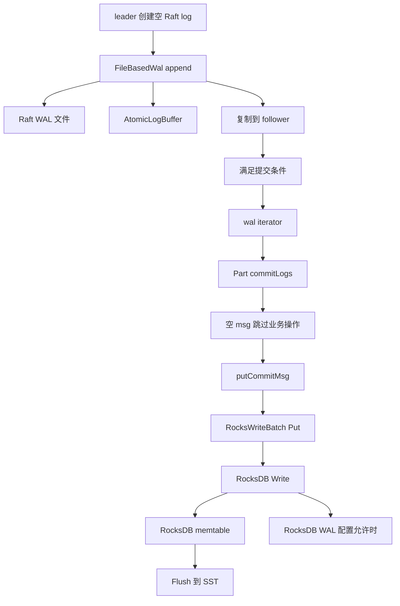

# 空闲 Raft 日志如何进入 RocksDB，以及各种内存统计的区别

本文解释本次问题中与 RocksDB、提交位置和进程内存有关的完整调用链。这里没有修复建议或业务语义修改。证据分三类：**当前仓库实际代码**、**本机链接的 RocksDB 7.5.3 公共头文件**、**已经执行的独立组件实验**。没有把公共接口注释当作已阅读第三方内部 `.cc` 的证据，也没有把组件实验称为完整 storaged 实验。

阅读入口：[Part.cpp](https://github.com/cccxgit/nebula/blob/de9b3ed800a6627d9845e9289b6bbc5b6faf460a/src/kvstore/Part.cpp#L215)、[RocksEngine.cpp](https://github.com/cccxgit/nebula/blob/de9b3ed800a6627d9845e9289b6bbc5b6faf460a/src/kvstore/RocksEngine.cpp#L120)、[MemoryUtils.cpp](https://github.com/cccxgit/nebula/blob/de9b3ed800a6627d9845e9289b6bbc5b6faf460a/src/common/memory/MemoryUtils.cpp#L83)。

## 1. 先区分本链路中的四种“日志/数据”

| 对象 | 所属层 | 空闲时写入内容 | 保存目的 |
|---|---|---|---|
| 空 Raft log | Raft | 新 logId、新 term/cluster，业务 `msg` 长度为 0 | 推进复制和提交 |
| Raft 磁盘 WAL 与 `AtomicLogBuffer` | `FileBasedWal` | 同一条 Raft log 的磁盘记录和内存副本 | 复制、回放和快速读取 |
| RocksDB 的 `systemCommitKey` | Part 状态机 | 某分片最近已提交的 logId 和 term | 恢复时知道状态机已经应用到哪里 |
| RocksDB 自身 WAL / memtable | RocksDB | 上面系统 key/value 的覆盖写 | RocksDB 的写入、恢复和落盘机制 |

两个 WAL 是不同实现。`rocksdb_disable_wal` 控制 RocksDB 的 WAL；它不会取消 Raft 的 `FileBasedWal`，也不会停止 `AtomicLogBuffer::push()`。

可以沿这条路径阅读：



图中“空 msg 跳过业务操作”后面仍有 `putCommitMsg`，这是解释空空间 RocksDB 内存增长的关键。

## 2. leader 和 follower 传给 `Part::commitLogs` 的到底是什么迭代器

### 2.1 leader 的提交入口

[RaftPart::processAppendLogResponses](https://github.com/cccxgit/nebula/blob/de9b3ed800a6627d9845e9289b6bbc5b6faf460a/src/kvstore/raftex/RaftPart.cpp#L1002) 接收复制结果。在多数派接受、当前任期和 leader 状态仍有效后，1068–1078 行执行：

```cpp
auto walIt = wal_->iterator(committedId + 1, lastLogId);
auto [code, lastCommitId, lastCommitTerm] =
    commitLogs(std::move(walIt), true, true);
```

`committedId + 1` 是尚未应用的起点，`lastLogId` 是本批可提交终点。调用成功后，1080–1083 行推进 `committedLogId_`、`committedLogTerm_`。

本函数虽然还持有 `AppendLogsIterator iter`，但传入 `Part::commitLogs` 的并不是那个待复制批次迭代器，而是重新通过 `wal_->iterator(...)` 获得的 **WAL 读取迭代器**。后面的内存缓存引用释放行为，应从这个实际对象类型判断。

### 2.2 follower 的追加和提交是两步

[RaftPart.cpp](https://github.com/cccxgit/nebula/blob/de9b3ed800a6627d9845e9289b6bbc5b6faf460a/src/kvstore/raftex/RaftPart.cpp#L1757) 的 1757–1777 行先将 RPC 中的记录封装为 `RaftLogIterator logIter`，调用 `wal_->appendLogs(logIter)`；这是把收到的记录追加到本地 WAL。

随后 1785–1797 行计算：

```cpp
LogID lastLogIdCanCommit = std::min(lastMatchedLogId, req.get_committed_log_id());
if (lastLogIdCanCommit > committedLogId_) {
  auto walIt = wal_->iterator(committedLogId_ + 1, lastLogIdCanCommit);
  commitLogs(std::move(walIt), false, false);
}
```

所以 follower 的“网络记录迭代器”和“状态机提交迭代器”也不是同一个对象。follower 的提交范围受 leader 已提交位置约束，可以暂时落后于自己已经追加到 WAL 的末尾。

### 2.3 WAL 读取先查内存，必要时回退到文件

[FileBasedWal::iterator](https://github.com/cccxgit/nebula/blob/de9b3ed800a6627d9845e9289b6bbc5b6faf460a/src/kvstore/wal/FileBasedWal.cpp#L530) 的 530–535 行：

```cpp
auto iter = logBuffer_->iterator(firstLogId, lastLogId);
if (iter->valid()) {
  return iter;
}
return std::make_unique<WalFileIterator>(shared_from_this(), firstLogId, lastLogId);
```

因此 `std::unique_ptr<LogIterator>` 的动态类型有两种：

- 最近记录仍在内存时，通常为 `AtomicLogBuffer::Iterator`。
- 起点不在内存缓冲时，为 `WalFileIterator`。

[AtomicLogBuffer::Iterator](https://github.com/cccxgit/nebula/blob/de9b3ed800a6627d9845e9289b6bbc5b6faf460a/src/kvstore/wal/AtomicLogBuffer.h#L191) 构造时 `addRef()`；[析构函数](https://github.com/cccxgit/nebula/blob/de9b3ed800a6627d9845e9289b6bbc5b6faf460a/src/kvstore/wal/AtomicLogBuffer.h#L136) 调用 `releaseRef()`。`commitLogs` 按值接收并拥有这个 `unique_ptr`，返回/提前返回后都会析构它。内存读者归零时可能触发 WAL dirty node 回收，但必须同时满足缓存自己的回收条件；**提交了一条空日志，并不意味着这条内存日志立刻被删除**。

若内存迭代器无效而返回文件迭代器，局部的无效内存迭代器也会析构、释放其读者引用。不能把所有读取路径都假定为磁盘访问，也不能认为 `Part::commitLogs` 持有一个永久不析构的 reader。

## 3. `Part::commitLogs` 为什么对空日志仍会写 RocksDB

[Part::commitLogs](https://github.com/cccxgit/nebula/blob/de9b3ed800a6627d9845e9289b6bbc5b6faf460a/src/kvstore/Part.cpp#L215) 先创建 batch，并将 `lastId`、`lastTerm` 初始化为未提交标记。循环内部的顺序非常重要：

```cpp
lastId = iter->logId();
lastTerm = iter->logTerm();
auto log = iter->logMsg();
if (log.empty()) {
  ++(*iter);
  continue;
}
```

`continue` 跳过的是当前记录的业务操作解码。因为 `lastId` 和 `lastTerm` 已经赋值，函数仍然知道自己遍历到了哪条日志。

非空日志的 234–344 行根据编码中的操作类型更新同一 batch：`OP_PUT`、`OP_MULTI_PUT`、删除、范围删除、批量写等分别转换成对应键值操作；成员变更和 leader 转移也有各自处理。空日志没有这些业务操作，因此不会创建业务顶点或边。

循环结束后 [349–358 行](https://github.com/cccxgit/nebula/blob/de9b3ed800a6627d9845e9289b6bbc5b6faf460a/src/kvstore/Part.cpp#L349) 仍然执行：

```cpp
if (lastId >= 0) {
  putCommitMsg(batch.get(), lastId, lastTerm);
}
engine_->commitBatchWrite(
    std::move(batch), FLAGS_rocksdb_disable_wal, FLAGS_rocksdb_wal_sync, wait);
```

所以若本批只有一条空日志，最终 batch 仍然包含一次系统提交 key 的 `Put`。若本批含多条日志，则提交位置通常是**每次 `commitLogs` 调用写一次**，值取本批最后遍历到的日志；不能在有批处理时简单宣称“每条 Raft log 恰好对应一次 RocksDB Put”。健康、低速、单条空心跳实验更接近一对一关系。

这个系统键的功能可以从恢复代码反向验证：[Part::lastCommittedLogId](https://github.com/cccxgit/nebula/blob/de9b3ed800a6627d9845e9289b6bbc5b6faf460a/src/kvstore/Part.cpp#L52) 读取它，检查值长度并解出 logId/term；[RaftPart::start](https://github.com/cccxgit/nebula/blob/de9b3ed800a6627d9845e9289b6bbc5b6faf460a/src/kvstore/raftex/RaftPart.cpp#L419) 使用结果初始化已提交位置。它是状态机应用进度，不是无用的日志附属物。

## 4. `putCommitMsg` 的 key/value 精确到字节

[Part::putCommitMsg](https://github.com/cccxgit/nebula/blob/de9b3ed800a6627d9845e9289b6bbc5b6faf460a/src/kvstore/Part.cpp#L403) 把两个有符号 64 位整数的原生内存表示直接拼接：

```text
value = committedLogId[8 bytes] || committedLogTerm[8 bytes]
```

固定为 16 字节，无字符串终止符，也不包含用户业务消息。这里 `reserve(16)` 只是临时字符串预留容量，不改变编码长度。

[NebulaKeyUtils::systemCommitKey](https://github.com/cccxgit/nebula/blob/de9b3ed800a6627d9845e9289b6bbc5b6faf460a/src/common/utils/NebulaKeyUtils.cpp#L101) 按以下方式构造 key：

```text
item = (partId << 8) | 0x04
type = 0x00000001
key = item[4 bytes] || type[4 bytes]
```

常量来自 [Types.h](https://github.com/cccxgit/nebula/blob/de9b3ed800a6627d9845e9289b6bbc5b6faf460a/src/common/utils/Types.h#L14)：`kSystem=4`、`kSystemCommit=1`，`kPartitionOffset=8` 在第 57 行。key 固定为 8 字节。因为每个 space 有自己的 DB，key 中不必再编码 spaceId。

在本次 x86_64 小端主机上，`partId=1, logId=1, term=1` 的例子为：

| 字段 | 十六进制字节 |
|---|---|
| `(1 << 8) \| 4` | `04 01 00 00` |
| `kSystemCommit` | `01 00 00 00` |
| 完整 key | `04 01 00 00 01 00 00 00` |
| logId | `01 00 00 00 00 00 00 00` |
| term | `01 00 00 00 00 00 00 00` |

下一次提交仅改变 value 中的 logId 或 term，key 不变。20 个本地分片对应 20 个此类逻辑 key。**逻辑 key 数不变，并不能推出 memtable 中只保留 20 份写入记录。**

24 字节是 key/value 的原始内容总长，不是实际内存分配大小。RocksDB 还需内部记录、索引/数据结构和分配 arena 的空间；下面用属性和组件实验验证真实增长。

## 5. batch 的生命期与 `wait` / `sync` / `disableWAL`

[RocksEngine::startBatchWrite](https://github.com/cccxgit/nebula/blob/de9b3ed800a6627d9845e9289b6bbc5b6faf460a/src/kvstore/RocksEngine.cpp#L120) 返回 `RocksWriteBatch`。[RocksWriteBatch](https://github.com/cccxgit/nebula/blob/de9b3ed800a6627d9845e9289b6bbc5b6faf460a/src/kvstore/RocksEngine.h#L181) 内部持有 `rocksdb::WriteBatch`，构造时按 `FLAGS_rocksdb_batch_size` 预留空间；源码默认值是 4096 字节，见 [RocksEngineConfig.cpp](https://github.com/cccxgit/nebula/blob/de9b3ed800a6627d9845e9289b6bbc5b6faf460a/src/kvstore/RocksEngineConfig.cpp#L41)。`put()` 直接调用 `batch_.Put(...)`。

batch 通过 `unique_ptr` 移交给 [RocksEngine::commitBatchWrite](https://github.com/cccxgit/nebula/blob/de9b3ed800a6627d9845e9289b6bbc5b6faf460a/src/kvstore/RocksEngine.cpp#L124)，函数调用 `db_->Write(options, b->data())`，结束时销毁临时 batch。长期增长应追踪 `DB::Write` 后 DB 持有的 memtable 等对象，而不是把每次临时 batch 的 4096 字节都永久累加。

三个参数分别对应：

| Nebula 参数 | RocksDB 赋值 | 本链路中的含义 |
|---|---|---|
| `disableWAL` | `WriteOptions.disableWAL` | 是否省略 RocksDB WAL；不跳过 memtable 写入 |
| `sync` | `WriteOptions.sync` | 写完成前是否执行同步持久化要求 |
| `wait` | `WriteOptions.no_slowdown = !wait` | 遇到 write stall 时允许等待，还是返回 Incomplete |

语义可直接核对本机 rocksdb/options.h（原实验机头文件 `/opt/vesoft/third-party/3.3/include/rocksdb/options.h:1689`）。因此这里的 `wait=true` **不是** `sync=true`，也不等于每次把 memtable flush 到 SST。

leader 传 `wait=true`，允许等待；follower 传 `wait=false`，若写入需要阻塞会返回 `Status::Incomplete()`，Nebula 映射为 `E_WRITE_STALLED`。follower 在 [RaftPart.cpp](https://github.com/cccxgit/nebula/blob/de9b3ed800a6627d9845e9289b6bbc5b6faf460a/src/kvstore/raftex/RaftPart.cpp#L1806) 暂不推进 committed 位置，后续请求还可以再次提交。`needLock` 则服务于状态机中需要 Raft 锁的特殊操作，与 RocksDB 持久化选项是另一件事。

## 6. 有多少 RocksDB 实例、配置在哪一层生效

[NebulaStore::addSpace](https://github.com/cccxgit/nebula/blob/de9b3ed800a6627d9845e9289b6bbc5b6faf460a/src/kvstore/NebulaStore.cpp#L395) 遍历 `options_.dataPaths_`，确保每个数据目录为该 space 创建一个 `KVEngine`。`SpacePartInfo` 中有多个 parts，它们按所属 engine 写对应 DB。

[RocksEngine 构造函数](https://github.com/cccxgit/nebula/blob/de9b3ed800a6627d9845e9289b6bbc5b6faf460a/src/kvstore/RocksEngine.cpp#L33) 把 DB 放在：

```text
<dataPath>/nebula/<spaceId>/data
```

而 `FileBasedWal` 在分片层维护。由此有两个不同维度：

- Raft 缓冲：主要按本机分片副本数增加。
- RocksDB engine / memtable：主要按本机 space × dataPath × column family 数增加；同一个 DB 中所有本地分片的系统提交写共同累积。

50 个 space、一个 dataPath、普通默认 CF，是 50 个 DB 的量级，不是 1000 个 DB。三个 storaged 进程中的 RocksDB 实例仍然是各进程自己的实例。

[initRocksdbOptions](https://github.com/cccxgit/nebula/blob/de9b3ed800a6627d9845e9289b6bbc5b6faf460a/src/kvstore/RocksEngineConfig.cpp#L222) 分别从 JSON flags 读取 DBOptions、ColumnFamilyOptions 和 BlockBasedTableOptions，然后组合。当前仓库的 [默认 storaged 配置](https://github.com/cccxgit/nebula/blob/de9b3ed800a6627d9845e9289b6bbc5b6faf460a/conf/nebula-storaged.conf.default#L102) 为 `write_buffer_size=67108864`、`max_write_buffer_number=4`。

本机 options.h（原实验机头文件 `/opt/vesoft/third-party/3.3/include/rocksdb/options.h:172`） 说明 `write_buffer_size` 按 column family 生效；advanced_options.h（原实验机头文件 `/opt/vesoft/third-party/3.3/include/rocksdb/advanced_options.h:249`） 说明 `max_write_buffer_number` 控制可同时存在的 write buffers 数。

所以 50 个 DB 的单个 64 MiB 活跃缓冲预算量级是 3.125 GiB；若按每 DB 最多 4 个 write buffers 粗算则是 12.5 GiB。它们是配置量纲，不能冒称严格的整个 storaged RSS 上限。分配开销、缓冲切换、被 pin 的对象和其他子系统都不在这个乘法中。

## 7. 为什么覆盖同一个 key 仍然增长，何时下降

本地第三方 advanced_options.h（原实验机头文件 `/opt/vesoft/third-party/3.3/include/rocksdb/advanced_options.h:328`） 明确列出 `inplace_update_support=false` 默认值，以及启用时何种条件允许就地覆盖。Nebula 当前初始化路径没有打开该选项，实际运行还应核对生成的 `OPTIONS-*` 文件。

正常写入路径把新的版本加入 memtable，逻辑查询选取相应可见版本；反复写同一个 user key 并不是对某个固定 16 字节内存槽不断 `memcpy`。旧版本和 arena 空间的回收由 memtable/flush/snapshot 等生命期决定。

本机安装目录提供公共头文件和 `librocksdb.a`，没有在本说明中声称已经逐行检查它内部的 `MemTable::Add`、skiplist 插入或 compaction 实现。这里“覆盖仍积累条目”的结论除了选项定义，还有第 11 节对同一链接库的直接运行验证：100 个逻辑 key 对应了 100 万个 active memtable entries。

内存通常有以下阶段：

1. 在 active memtable 中不断写入。低吞吐空间要花较长时间才能达到空间阈值。
2. 达到 flush 条件或显式发起 flush 后，旧 memtable 转为 immutable，并由 flush 写出 SST。
3. 相应引用退出后，旧 memtable 的内存可以归还给分配器。被引用的 immutable 可能仍计入 `size-all-mem-tables`。
4. 分配器释放对象和操作系统 RSS 下降没有一一对应关系。

这里不能将“64 MiB 后必定立刻少 64 MiB RSS”作为预期。可直接观测的属性含义来自本机 db.h（原实验机头文件 `/opt/vesoft/third-party/3.3/include/rocksdb/db.h:920`）：

| 属性 | 范围 | 单位/注意 |
|---|---|---|
| `cur-size-active-mem-table` | active memtable | 近似字节 |
| `cur-size-all-mem-tables` | active + 未 flush 的 immutable | 近似字节 |
| `size-all-mem-tables` | 再包括被 pin 的 immutable | 近似字节 |
| `num-entries-active-mem-table` | active 中的 entries | 不等于不同 user key 的数量 |
| `num-entries-imm-mem-tables` | 未 flush immutable 的 entries | 条目数 |
| `estimate-num-keys` | DB 的估算 key 计数 | 不是用户顶点数，也不是本实验的精确去重校验 |
| `estimate-table-readers-mem` | SST reader 等，排除 block cache | 近似字节 |

不能把这三个重叠的 memtable size 属性相加。通常选择其中一个作为主要指标，其余用于解释 pinned/immutable 的差别。

### 7.1 真实服务的 1 MiB 基线与 arena 分配台阶

真实服务开始采样时，每个目标 space 的 memtable 为 **1,050,624 字节**，50 个 space 共 52,531,200 字节。它不代表多了一个 Nebula 独有的 1 MiB 缓存，也不能与组件实验中“刚打开 DB、还没写入”时的 2,048 字节直接对比。

实际服务和原组件的 `OPTIONS-*` 都为 `arena_block_size=1048576`、`write_buffer_size=67108864`、`memtable_prefix_bloom_size_ratio=0`。本机 advanced_options.h（原实验机头文件 `/opt/vesoft/third-party/3.3/include/rocksdb/advanced_options.h:477`） 说明未指定 arena 块大小时，通常从 `write_buffer_size/8` 推导并限制到不超过 1 MiB。这解释了 64 MiB write buffer 对应的 1 MiB arena 分配粒度。

同一个组件二进制的小实验中，20 次覆盖时 memtable 仍为 2,048 字节，60 次覆盖时已为 `2,048 + 1,048,576 = 1,050,624` 字节。真实服务每个 space 在初次有效采样时已有约 250 个内部 entries；创建 engine 的 dataVersionKey、创建分片的 systemPartKey，以及空心跳提交记录，都先于这一采样时点发生。参见 [RocksEngine.cpp](https://github.com/cccxgit/nebula/blob/de9b3ed800a6627d9845e9289b6bbc5b6faf460a/src/kvstore/RocksEngine.cpp#L83) 和 [addPart](https://github.com/cccxgit/nebula/blob/de9b3ed800a6627d9845e9289b6bbc5b6faf460a/src/kvstore/RocksEngine.cpp#L363)。

因此，entries 可以在某段时间持续增加而 memtable 字节属性保持平台；继续使用已申请 arena 空间时，字节统计不会每次 Put 都增加。也不能用该平台严格排除 RocksDB 对 RSS 的所有影响：后续写入可能触碰尚未驻留的页面。完整配置快照、组件小实验和实际初始时间序列见 [运行期 RocksDB 分析](../../task/wal-investigation/runtime-rocks-analysis.txt)。

## 8. `cleanWAL` 与 RocksDB flush 的关系

[NebulaStore::init](https://github.com/cccxgit/nebula/blob/de9b3ed800a6627d9845e9289b6bbc5b6faf460a/src/kvstore/NebulaStore.cpp#L72) 首次安排 `cleanWAL`，间隔默认 600 秒。`cleanWAL` 结束通过 `SCOPE_EXIT` 再安排下一次；这不是逐条日志的 TTL 定时器。

[NebulaStore::cleanWAL](https://github.com/cccxgit/nebula/blob/de9b3ed800a6627d9845e9289b6bbc5b6faf460a/src/kvstore/NebulaStore.cpp#L1293) 的顺序是：

```cpp
for (space : spaces_) {
  if (FLAGS_rocksdb_disable_wal) {
    for (engine : space.engines_) {
      engine->flush();
    }
  }
  for (part : space.parts_) {
    if (part->needToCleanWal()) {
      part->cleanWal();
    }
  }
}
```

由此可以确认：

- `rocksdb_disable_wal=false` 时，这个维护任务不会因为遍历空间而额外调用 engine flush。
- `rocksdb_disable_wal=true` 时，它会先对每个 engine 做 flush，再处理 Raft WAL 清理。
- 因此改变这个配置会同时改变 RocksDB WAL 写入和周期性 flush 行为，不能当成只影响磁盘日志的单因素。
- 后面的 `part->cleanWal()` 是 Raft 磁盘 WAL 保留逻辑，不是 memtable flush，也不是按 TTL 清空 AtomicLogBuffer。

[RocksEngine::flush](https://github.com/cccxgit/nebula/blob/de9b3ed800a6627d9845e9289b6bbc5b6faf460a/src/kvstore/RocksEngine.cpp#L540) 构造默认 `rocksdb::FlushOptions` 并调用 `db_->Flush`。本机 FlushOptions（原实验机头文件 `/opt/vesoft/third-party/3.3/include/rocksdb/options.h:1779`） 的默认 `wait=true`，此处才是等待 flush 完成的选项。

显式 `SUBMIT JOB FLUSH` 的存储端 [FlushTask::genSubTasks](https://github.com/cccxgit/nebula/blob/de9b3ed800a6627d9845e9289b6bbc5b6faf460a/src/storage/admin/FlushTask.cpp#L17) 找到 space，再遍历它的 engines 调用同一个 `engine->flush()`。这条任务链没有调用 AtomicLogBuffer 清空接口，因此可作为区分 RocksDB memtable 与 Raft 缓冲的观测操作。它有落盘工作量，实验时应记录操作时间与 job 完成状态。

## 9. block cache、row cache 与 table reader 为什么不能混算

[RocksEngineConfig.cpp](https://github.com/cccxgit/nebula/blob/de9b3ed800a6627d9845e9289b6bbc5b6faf460a/src/kvstore/RocksEngineConfig.cpp#L307) 中：

```cpp
static std::shared_ptr<rocksdb::Cache> blockCache = NewLRUCache(...);
bbtOpts.block_cache = blockCache;
static std::shared_ptr<rocksdb::Cache> rowCache = NewLRUCache(...);
baseOpts.row_cache = rowCache;
```

函数局部 `static` 只初始化一次。普通 BlockBasedTable 路径中的这些缓存由**同一进程的各 DB 共享**，不会因为创建 50 个空间就变成 50 份相同容量；不同 storaged 进程之间则不共享。

`rocksdb_block_cache` 使用 MiB 单位再乘 `1024*1024`；源码 gflag 默认 1024，仓库默认配置实际为 4，生产配置为 4096。必须记录真正使用的 flags。

`rocksdb_row_cache_num` 的 flag 文案写“keys”，但实际直接作为 `NewLRUCache` 的 `capacity` 传入，没有按 key 数乘某个平均条目大小。本机 cache.h（原实验机头文件 `/opt/vesoft/third-party/3.3/include/rocksdb/cache.h:112`） 定义的是 cache capacity，因此这里按字节预算理解，默认参数 16000000。不要根据 flag 名称把它当成每个空间可存 1600 万条记录。

缓存容量也不是严格 RSS 界限：同一 NewLRUCache 接口（原实验机头文件 `/opt/vesoft/third-party/3.3/include/rocksdb/cache.h:120`） 的 `strict_capacity_limit` 默认 false，缓存元数据、被 pin 的条目和 allocator 自身开销需分开考虑。

db.h（原实验机头文件 `/opt/vesoft/third-party/3.3/include/rocksdb/db.h:952`） 明确说明 `estimate-table-readers-mem` 不包含 block cache。`enable_partitioned_index_filter` 分支才设置 `cache_index_and_filter_blocks=true`，见 [RocksEngineConfig.cpp](https://github.com/cccxgit/nebula/blob/de9b3ed800a6627d9845e9289b6bbc5b6faf460a/src/kvstore/RocksEngineConfig.cpp#L321)。因此只看 block cache usage 并不能覆盖全部 SST index/filter/reader 内存。

采样规则应是：memtable/table-reader 依次对各 space、各 engine 求和；block-cache-usage/pinned/capacity 对同进程只取一份。本次 sampler 为避免跨 space 重复计数，取这些共享指标的最大值。它不能消除多 HTTP 请求之间的时间差，但不会把一个 4 MiB 缓存误报成 200 MiB。

## 10. 空闲时到底有没有执行 `MemoryUtils` purge

### 10.1 调用入口不依赖用户查询

[StorageServer::start](https://github.com/cccxgit/nebula/blob/de9b3ed800a6627d9845e9289b6bbc5b6faf460a/src/storage/StorageServer.cpp#L309) 最后调用 `setupMemoryMonitorThread()`。[该函数](https://github.com/cccxgit/nebula/blob/de9b3ed800a6627d9845e9289b6bbc5b6faf460a/src/storage/StorageServer.cpp#L73) 启动专门的 `storage-memory-monitor` worker，先执行一次 `hitsHighWatermark()`，再按 `check_memory_interval_in_secs` 注册重复任务；源码默认间隔 1 秒。

因此正常运行的 storaged 即使完全无业务请求，也会执行这个监测入口。其目的既有设置内存水位标志，也有触发 MemoryTracker 维护。

### 10.2 到达 purge 还有明确的前提

[MemoryUtils::hitsHighWatermark](https://github.com/cccxgit/nebula/blob/de9b3ed800a6627d9845e9289b6bbc5b6faf460a/src/common/memory/MemoryUtils.cpp#L83) 的第一条分支是：

```cpp
if (FLAGS_system_memory_high_watermark_ratio >= 1.0) {
  return false;
}
```

若这个 ratio 设为 1 或更高，函数立即返回，后面的 `handleMemoryTracker()` 和 purge 都不会执行。设置 `memory_purge_enabled=true` 本身不足以保证调用实际发生。

未提前返回时，函数读取系统 `/proc/meminfo` 或配置的 cgroup 文件，计算 total/available，然后在第 130 行调用 `handleMemoryTracker(total, available)`。文件读取失败或非容器路径无法获得足够字段时也可能提前退出。

[handleMemoryTracker](https://github.com/cccxgit/nebula/blob/de9b3ed800a6627d9845e9289b6bbc5b6faf460a/src/common/memory/MemoryUtils.cpp#L149) 的主体包在 `#ifdef ENABLE_MEMORY_TRACKER` 中。当前构建的 flags.make（原实验机构建文件 `../../build/src/common/memory/CMakeFiles/memory_obj.dir/flags.make:5`，不随 Git 交付） 确认含 `-DENABLE_MEMORY_TRACKER -DENABLE_JEMALLOC`；[CMakeLists.txt](https://github.com/cccxgit/nebula/blob/de9b3ed800a6627d9845e9289b6bbc5b6faf460a/CMakeLists.txt#L68) 要求打开 jemalloc 且关闭 ASAN 才启用该 tracker。

在上述前提下，[200–207 行](https://github.com/cccxgit/nebula/blob/de9b3ed800a6627d9845e9289b6bbc5b6faf460a/src/common/memory/MemoryUtils.cpp#L200) 才执行：

```cpp
if (FLAGS_memory_purge_enabled) {
  if (now - kLastPurge_ > FLAGS_memory_purge_interval_seconds) {
    mallctl("arena.<ALL>.purge", nullptr, nullptr, nullptr, 0);
    kLastPurge_ = now;
  }
}
```

比较符是 `>`，不是 `>=`；默认 interval 为 10 秒，并经约 1 秒的监测任务检查，因此不能把每次 purge 的时间精确说成“固定每 10 秒”。调用返回值没有在该代码中检查；源码可证明会尝试调用，不能仅凭 flag 或这条路径断言系统调用每次都成功回收了多少页面。

### 10.3 purge 的作用范围

这段代码只请求 allocator 清理 arena 中可回收的页面，没有调用 WAL 的 reset/delete，也没有调用 RocksDB flush。仍被 `AtomicLogBuffer` 或 active memtable 持有的对象不能靠这个 purge 消失。

所以“已经配置后台 purge”与“空闲时 WAL 存活节点、memtable 大小继续上涨”并不矛盾。反过来，某次 flush 后 RSS 暂时没降，也不能证明 memtable 对象没释放；需要看具体对象计数和 allocator 的存活分配指标。

### 10.4 MemoryTracker、jemalloc stats、RSS 是三层不同统计

[NewDelete.cpp](https://github.com/cccxgit/nebula/blob/de9b3ed800a6627d9845e9289b6bbc5b6faf460a/src/common/memory/NewDelete.cpp#L17) 在启用 tracker 时覆盖 new/delete。[Memory.h](https://github.com/cccxgit/nebula/blob/de9b3ed800a6627d9845e9289b6bbc5b6faf460a/src/common/memory/Memory.h#L80) 用 `nallocx()` 计算分配器大小类别、用 `sallocx()` 对释放计费，再更新 Nebula 的 MemoryTracker。

[MemoryTracker.h](https://github.com/cccxgit/nebula/blob/de9b3ed800a6627d9845e9289b6bbc5b6faf460a/src/common/memory/MemoryTracker.h#L47) 说明线程有本地预留配额，全局 `used()` 可能包含尚未实际使用的 reservation。直接 malloc/free 的路径也不能简单认定等同于被重载 new/delete 的跟踪范围。于是日志里的 `usr` 既不是 `/proc` RSS，也不自动等于 jemalloc 全部分配统计。

| 观测量 | 应如何解读 |
|---|---|
| WAL logical bytes / node count | 特定数据结构的内容计费与仍存活对象数量 |
| RocksDB memtable property | 某 DB 内 memtable 的近似内存，按 engine 聚合 |
| Nebula MemoryStats `used()` | new/delete 跟踪与线程配额体系的计费 |
| jemalloc `stats.allocated` | 分配器对存活分配的统计；读取前刷新 epoch |
| jemalloc active/resident/retained | allocator 页面和保留地址空间等其他层次；不应直接当成业务 live bytes |
| `/proc/PID/status` 的 VmRSS、RssAnon | 内核对进程驻留页的观测；包含各子系统贡献 |
| `/proc/PID/smaps_rollup` 的 RSS/PSS | 映射驻留/共享摊销的另一组观测 |

不能把这些量机械相加：memtable 和 WAL 的内存本来就可能同时包含在 allocated 和 RSS 中。它们是解释同一进程内存的不同视角。

## 11. 已执行的 RocksDB 独立组件实验

源码：[rocks-commit-probe.cpp](../../task/wal-investigation/rocks-commit-probe.cpp)。完整命令、配置和边界：[复现说明](../../task/wal-investigation/rocks-commit-probe-reproduction.txt)。原始序列：[CSV](../../task/wal-investigation/rocks-commit-probe.csv)，配置/校验：[meta](../../task/wal-investigation/rocks-commit-probe.meta)。

实验使用当前链接库，5 个 DB，每 DB 20 个系统提交 key，覆盖 10000 轮，共 1000000 次单 Put batch。key/value 按第 4 节同样的字节构造。选择较小 DB 数是为了节省机器资源；**没有将它冒称为 3 storaged × 50 space 的服务复现**。

| 时点 | 写入累计 | memtable 字节总计 | active entries | jemalloc allocated | RSS KiB |
|---|---:|---:|---:|---:|---:|
| 打开 5 DB | 0 | 10,240 | 0 | 2,481,912 | 11,292 |
| 覆盖写完成 | 1,000,000 | 52,439,040 | 1,000,000 | 54,700,736 | 63,544 |
| 同步 flush 完成 | 1,000,000 | 10,240 | 0 | 5,881,248 | 64,144 |

全程共享 block cache usage 为 96 字节。最后精确遍历校验只有 100 个逻辑 key，且所有 value 都是最后一轮 logId/term。

这里可以直接得出三个实验结论：

1. 重复写相同的 100 个系统 key，仍可产生 100 万条 active memtable entries，增长约 50 MiB。
2. flush 后 memtable 和 allocated 明显下降，说明相应存活分配已被释放或显著减少。
3. 同一时点 RSS 未下降，因此不能只用 RSS 判定对象是否还活着。

本次约 52.43 字节/次写的 memtable 平均增量，包含 arena 分配粒度，是这个配置和区间的实测比例；它不是任何版本/任意 batch/任意负载都固定不变的单条成本。本驱动没有运行 Nebula 的周期 memory monitor，因此其 flush 后 RSS 不能直接预测启用 Nebula 后台 purge 的服务长时间表现。

## 12. 对真实 storaged 证据应该怎样做归因

真实服务必须同时观察“业务空闲、Raft 仍在提交”和各子系统的时间序列。推荐顺序是：

1. 确认 topology、实际 flags、PID 和 `/proc` starttime，不把空间创建、重启或节点加入期混入稳态。
2. 用 WAL 观测确认新增日志数、空消息数、live node 数和 dirty/GC 行为。
3. 从全部 space 的 HTTP property 获得 memtable 总量；共享 cache 只计一次，SST reader 单独看。
4. 若显式 flush，确认 task 完成，并比较操作前后 memtable、WAL 节点、allocated 和 RSS，而不是只比较 RSS。
5. 对采样失败、空间元数据未同步、WAL 并发尾部不完整的行明确剔除或标注。

本次 [sample_runtime.py](../../task/wal-investigation/sample_runtime.py) 使用空间名称调用 `/rocksdb_property`，因为 [StorageHttpPropertyHandler](https://github.com/cccxgit/nebula/blob/de9b3ed800a6627d9845e9289b6bbc5b6faf460a/src/storage/http/StorageHttpPropertyHandler.cpp#L32) 调用 `schemaMan_->toGraphSpaceID(spaceName)`；[ServerBasedSchemaManager](https://github.com/cccxgit/nebula/blob/de9b3ed800a6627d9845e9289b6bbc5b6faf460a/src/common/meta/ServerBasedSchemaManager.cpp#L94) 再查本地 metadata cache。

HTTP 返回数组按请求 property 顺序排列，每项为 `{"Engine 0":"数值",...}`，不是带 property 名的字典。脚本同时保存成功空间数、engine 数和原始响应，以检查聚合是否完整。对 50 space、单 dataPath 的三副本实验，每台有效稳态行应满足 `http_spaces_ok=50`、`http_spaces_failed=0`、`http_engines=50`；还应核对本机 1000 个 WAL 分片目录和解析错误数。

磁盘 WAL 首尾 logId 推算的记录数不等于当前内存缓存条数，特别是重启、GC 或磁盘文件清理后。最终将真实服务的增长归因给哪一层，必须以服务自己的这些计数为依据，而不是只套用本组件实验或配置预算。
