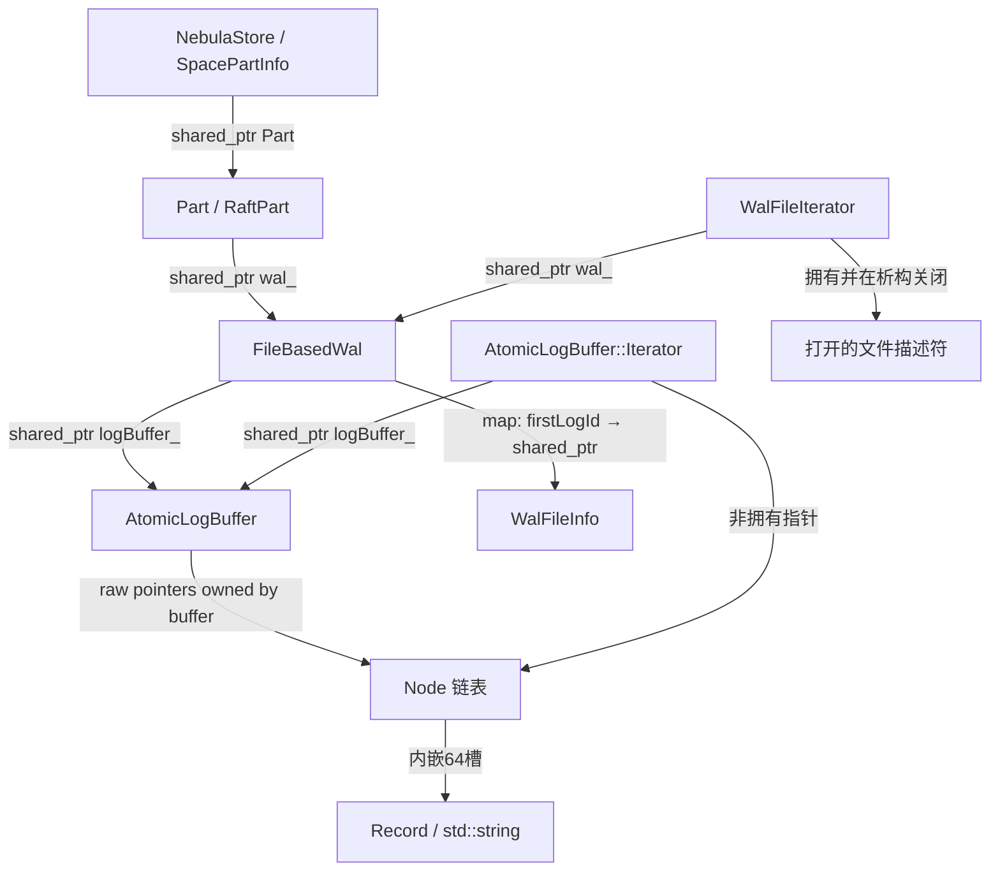

# WAL、Raft空日志与内存生命周期：逐函数代码解读

本文用于理解 `task/task-wal.md` 涉及的实现，解释“为什么没有业务写入还会增加内存、谁持有内存、什么时候只是失效、什么时候真正delete”。不提供修复方案，不改变既有算法。

代码基线：`de9b3ed800a6627d9845e9289b6bbc5b6faf460a`。由于 `src/kvstore/wal/AtomicLogBuffer.cpp` 另加了允许的观测代码，本文的 **AtomicLogBuffer.cpp行号统一引用固定基线副本**：[baseline/kvstore/wal/AtomicLogBuffer.cpp](../../task/wal-investigation/baseline/kvstore/wal/AtomicLogBuffer.cpp)。该文件由 `git show` 原样提取；其头文件也保存在同目录。其它源文件按当前工程行号引用。

实验与定量结果见 [COMPONENT-ANALYSIS.md](../../task/wal-investigation/COMPONENT-ANALYSIS.md)。本文重点是运行过程中对象和状态如何变化。

## 1. 先分清四层对象与两类日志

本问题涉及的主要层次是：

| 层次 | 主要对象 | 职责 | 本问题中的内存或文件 |
|---|---|---|---|
| Raft | `RaftPart`、`Host` | 分配日志ID、复制、commit、心跳、选举 | 短期请求/队列/iterator；持有分片WAL |
| Raft WAL文件 | `FileBasedWal`、`WalFileInfo` | 持久化和恢复Raft日志、文件滚动/清理 | `.wal`文件及少量文件索引 |
| Raft WAL内存缓存 | `AtomicLogBuffer`、`Node`、`Record` | 给复制/提交提供最近日志的内存读取 | 64槽Node链表，是本次已确认增长来源 |
| 状态机 | `Part`、`RocksEngine`、RocksDB | 应用业务操作，记录已提交位置 | memtable、SST、RocksDB自身WAL/cache等 |

Raft的`.wal`与RocksDB自身WAL不是同一套文件。`wal_buffer_size`控制Raft内存缓存逻辑容量；`rocksdb_disable_wal`控制RocksDB写选项，且本工程还会因它改变定时flush行为。

同样，Heartbeat RPC与空payload的AppendLog不是同一条网络路径。稳定空闲时，`sendHeartbeat()`可以同时安排这两种动作。空WAL记录仍有LogID、TermID、ClusterID，只有payload长度为0。

## 2. 所有权：谁保证对象还活着

主要关系如下，箭头注明的是持有关系，不是函数调用：



这里有两种完全不同的“引用计数”：

- `shared_ptr<AtomicLogBuffer>`的控制块保证缓存对象自身不会在iterator仍持有时析构。
- `AtomicLogBuffer::refs_`是类自己维护的“当前存在几个内存iterator”，用于决定脏Node是否可以物理回收。它不是shared_ptr的use_count，也不是每个Node的单独引用计数。

缓存通过raw pointer串联Node，并不意味着无人拥有。Node的创建、标删、物理delete和最终析构由`AtomicLogBuffer`负责；只要仍挂在链上就是可达内存。

`FileBasedWal::getWal()`和`AtomicLogBuffer::instance()`都是工厂，每次创建新对象，名字中有`instance`不代表全局共享单例。每个RaftPart会按照policy建立自己的缓存，见 [RaftPart.cpp:357](../../src/kvstore/raftex/RaftPart.cpp:357)、[FileBasedWal.cpp:59](../../src/kvstore/wal/FileBasedWal.cpp:59)、[AtomicLogBuffer.h:252](../../src/kvstore/wal/AtomicLogBuffer.h:252)。

## 3. Record：消息内容与容量计账

定义在 [AtomicLogBuffer.h:23](../../src/kvstore/wal/AtomicLogBuffer.h:23)。

`Record(clusterId, termId, StringPiece msg)`会把`msg`转成自己拥有的`std::string`。传入`StringPiece`只是一个非拥有视图；Record构造完成后并不依赖原调用者字符串继续存在。

Record包含：

```text
ClusterID clusterId_  → int64_t
TermID    termId_     → int64_t
std::string msg_     → 拥有payload
```

`Record::size()`的实现是：

```text
sizeof(ClusterID) + sizeof(TermID) + msg_.size()
```

它不是`sizeof(Record)`，也不是`malloc_usable_size`。它不计`std::string`对象本体、不计padding、不计Node指针/原子状态、不计分配器档位。对空payload，返回固定16B。

本机构建实测`sizeof(std::string)=32`、`sizeof(Record)=48`。空string未产生独立payload堆块，但string对象本身仍占槽位。非空大payload还会有额外字符串分配，不能继续用本报告的56B/条空记录模型计算。

## 4. Node：为什么一条空记录也要分配64槽

定义在 [AtomicLogBuffer.h:44](../../src/kvstore/wal/AtomicLogBuffer.h:44)。`kMaxLength=64`，`records_`是固定数组而不是按记录数动态增长的vector。

### 4.1 字段的真实含义

| 字段 | 含义 |
|---|---|
| `firstLogId_` | 这个Node第一条记录的ID，用于以ID差计算槽位 |
| `size_` | 此Node内已写入记录的逻辑计账总和；不是该Node的堆字节 |
| `pos_` | 下一个可写槽位，也就是已写记录数量 |
| `next_` | 指向**更旧**的Node |
| `prev_` | 指向**更新**的Node，reader按日志ID递增时使用 |
| `markDeleted_` | 这个Node是否逻辑失效；为true不代表已经delete |
| `records_` | cacheline对齐的64个Record对象 |

本机实测Node对象3200B、对齐64B；项目jemalloc实际分配3584B。第1条与第64条占用同一个Node，第65条需要第二个Node，所以有效计账连续按16B增长，实际分配按3584B台阶增长。

### 4.2 `isFull()`与`push_back()`

[Node::isFull():50](../../src/kvstore/wal/AtomicLogBuffer.h:50)判断`pos_==64`，不是检查字节容量。

[Node::push_back():60](../../src/kvstore/wal/AtomicLogBuffer.h:60)按以下顺序做事：

1. 如果64槽已满，返回false。
2. 将Record的逻辑size累加到Node::size_。
3. 将Record移动到`records_[pos]`，其string所有权也转入槽位。
4. `pos_.fetch_add(1, release)`发布这个已写槽位。

reader读取`pos_`时使用acquire，使“看到位置增加”与“能看到此前写好的记录”建立发布关系。这里的并发契约是**单writer、多reader**；存在atomic字段不意味着可随意并发调用多个push。FileBasedWal头也明确append/rollback不支持多writer。

### 4.3 `rec()`与ID边界

[Node::rec():77](../../src/kvstore/wal/AtomicLogBuffer.h:77)返回指定槽位Record的地址，不复制对象，也不增加Node级引用。实际使用安全性依赖iterator生命周期和已发布位置。

阅读时要注意一个命名细节：[Node::lastLogId():92](../../src/kvstore/wal/AtomicLogBuffer.h:92)原实现返回`firstLogId_ + pos_`，并非字面上“最后一个已写槽位ID”的`first+pos-1`。普通遍历还会在到达`pos_`时转向下一个Node或结束。本报告不依赖这个名字反推准确记录数，而用显式push计数和文件记录解析。这里保留原实现进行解读，没有把边界细节作为此次内存增长原因或进行改写。

## 5. 链表方向：head最新，tail最老有效，tail之后仍可能有节点

缓冲字段定义在 [AtomicLogBuffer.h:353](../../src/kvstore/wal/AtomicLogBuffer.h:353)。在正常状态下，沿`next_`看是从新到旧：

```text
head_
  │
  ▼
[最新/可写 A] --next--> [有效 B] --next--> [最老有效 C] --next--> [脏 D] --next--> [脏 E]
                           --prev--> A        --prev--> B
                                             ▲
                                             │
                                           tail_
```

图中的`prev_`方向恰好相反，指向更新Node。reader先定位旧日志所在Node，再递增槽位；跨Node时走`prev_`，从旧日志读到新日志。

必须同时区分三个集合：

- 有效区间：从head沿next走到tail，通常这些Node没有标删。
- 脏区间：tail之后、仍通过next连接的旧Node，它们已经标删，逻辑容量不再计算，但对象与string还占内存。
- 已释放区间：GC从链表切断并真正delete的Node，已经不存在。

`tail_`不是整条物理链表的尾部；`tail_->next_`不一定是nullptr。这正是“逻辑size已经稳定、实际内存仍增长”的关键区别。

## 6. AtomicLogBuffer的构造与push：两条分支要分开读

### 6.1 构造不预分配8MiB

[构造函数:327](../../src/kvstore/wal/AtomicLogBuffer.h:327)只是保存capacity。head/tail初始为空，size/refs/dirty初始为0。

因此创建1000个buffer，并不立即分配1000×8MiB。大量实际Node是在后续空日志积累过程中渐进分配的；这也解释“空间建好后继续慢慢涨”。

### 6.2 `push(logId,term,cluster,msg)`包装层

[头文件:270](../../src/kvstore/wal/AtomicLogBuffer.h:270)先构建拥有payload的Record，再调用`push(logId, Record&&)`。实际链表与容量逻辑在 [原始cpp:71](../../task/wal-investigation/baseline/kvstore/wal/AtomicLogBuffer.cpp:71)。

### 6.3 分支A：必须创建新Node

条件是`head==nullptr || head->isFull() || head->markDeleted_`。

操作顺序为：

1. `new Node()`，实际获得64槽。
2. `newNode.firstLogId_=logId`，`newNode.next_=oldHead`。
3. 向新Node写入当前Record。
4. 如果之前没有有效head，或head已标删，则重设buffer的`firstLogId_`和`tail_=newNode`。
5. 否则把旧head的`prev_`发布为newNode。
6. 逻辑size加当前Record，`head_=newNode`，**立即return**。

这个分支没有走后面的capacity检查。因此满节点后的第65条、第129条等可能暂时超过逻辑容量。默认8MiB的纯空记录实验中，第524289条正好是新Node首条，逻辑size变为8388624B，但还没有标脏任何旧Node。

reset之后第一次push也走这个分支：建立新的有效head/tail，而旧的已标删链仍接在新Node.next之后，等待后续GC。

### 6.4 分支B：向现有未满head追加

只有分支A不满足时，才来到 [原始cpp:91](../../task/wal-investigation/baseline/kvstore/wal/AtomicLogBuffer.cpp:91)。

如果`size_+recSize>capacity_`，取tail并检查`tail!=head`：

1. 尝试把旧tail的`markDeleted_`从false变true。
2. 从tail的`prev_`得到下一个更新Node，更新`firstLogId_`。
3. 推进tail。
4. 标记成功时，从buffer size_扣去旧tail逻辑size，dirtyNodes加1。
5. 最后把本条recSize加回buffer size_，向head写记录。

这里只标记**一个**Node，不是while循环清理直到某个字节目标，也没有在此delete。

当tail==head时，当前只有一个有效Node，代码不会把唯一可写Node标删。Node满不满按64条判断，容量却按字节判断，因此大记录或极小capacity下，单Node也可以超过capacity。源码91–98行的TODO正解释了这种粒度差异。本文的纯空记录实验使用正常或小容量验证边界，没有修改这一行为。

### 6.5 三个不同的size

```text
Record::size()     = 单条逻辑计账
Node::size_        = 这个Node里所有已写Record的逻辑计账
Buffer::size_      = 当前有效区间的逻辑计账，不含已标删Node
真实仍占堆字节     = 所有未delete Node的分配 + 非SSO字符串分配 + 分配器开销
```

当旧tail被标删后，它的Node::size_仍保留，但Buffer::size_已经扣掉。诊断补丁的`live_logical_bytes`按未delete节点统计，包含脏区间，不能与`buffer_size`直接当作同一个量。

## 7. 内存iterator：读者保护整个buffer，读取的是一段快照

### 7.1 构造与`addRef()`

[iterator():315](../../src/kvstore/wal/AtomicLogBuffer.h:315)创建`unique_ptr<Iterator>`。Iterator内部持有buffer的shared_ptr；[构造函数:191](../../src/kvstore/wal/AtomicLogBuffer.h:191)先`addRef()`，再固定end并seek起点。

`addRef()`只是全buffer计数`refs_.fetch_add(1)`。即便seek失败、iterator一开始无效，也已经增加了refs；退出时仍会减回去并可能触发GC。这对FileBasedWal回退文件iterator时的行为很重要。

end固定在创建时，之后writer继续追加的日志不会让这个iterator无限追随最新位置。它不是持续订阅日志流。

### 7.2 `AtomicLogBuffer::seek(logId)`

见 [原始cpp:138](../../task/wal-investigation/baseline/kvstore/wal/AtomicLogBuffer.cpp:138)。

它先处理空head和过新的ID，然后从head沿next向旧节点查找，限定在当前有效区间附近，并拒绝已标删节点。找到第一个`logId >= node.firstLogId_`的Node后返回。复杂度最坏随节点数增长；最近日志通常就在head，所以常见读取很短。

这里不是按日志ID构建每条hash索引，也没有每条独立LogID字段。Node记录第一条ID，连续ID通过槽位偏移表达。

### 7.3 `Iterator::seek()`、`record()`、`logMsg()`

[原始cpp:42](../../task/wal-investigation/baseline/kvstore/wal/AtomicLogBuffer.cpp:42)取得Node后，计算`currIndex_=logId-node.firstLogId_`，保存当前Record指针；找不到则valid=false。

`logTerm()`、`logSource()`、`logMsg()`分别读取当前Record字段。`logMsg()`返回StringPiece，不复制payload；调用者若需要比iterator更长的生命期，必须自己复制。Raft Host准备RPC时确实调用`toString()`，把内容拷贝到请求结构。

### 7.4 `Iterator::operator++()`

见 [原始cpp:15](../../task/wal-investigation/baseline/kvstore/wal/AtomicLogBuffer.cpp:15)：

1. currIndex和currLogId递增。
2. 超过创建时固定的end，立刻失效。
3. 读取当前Node已发布的pos。
4. 槽位达到pos，沿`prev_`转向更新Node；若不存在则结束；存在则槽位归0。
5. 保存新的Record指针。

因此定位时走`next_`（从新找旧），正向读日志时走`prev_`（从旧到新）。把链方向读反，会误以为GC在删除最新日志。

## 8. releaseRef与GC：逻辑删除何时变为物理释放

Iterator析构 [AtomicLogBuffer.h:136](../../src/kvstore/wal/AtomicLogBuffer.h:136)调用 [原始releaseRef():167](../../task/wal-investigation/baseline/kvstore/wal/AtomicLogBuffer.cpp:167)。它是本类常规GC的入口；没有独立定时GC线程。

### 8.1 为什么先读tail，再减refs

顺序是：

```text
oldTail = tail_.load(acquire)
previousReaders = refs_.fetch_sub(1)
```

`previousReaders`是减1之前的值。大于1意味着还有旧reader，函数直接返回；等于1意味着这次离开的是当时最后一个reader。

先捕获tail是为了使本次回收边界不新于后来reader可能看到的有效边界。即使refs减到0后马上有新的reader加入，它只应读取当前有效区间，而本次GC只回收旧tail之后的已失效节点。原代码采用这一并发回收约定；本文解释其意图与执行条件，不把单线程组件实验当作完整并发正确性证明。

因为计数是全buffer的，一个iterator并不是只保护自己当前站着的那个Node。只要一直有旧reader存在，就可能让整段dirty链不能进入这次GC分支。

### 8.2 为什么refs归零仍不一定delete

最后reader离开后，还要检查：

```text
dirtyNodes > dirtyNodesLimit_ (=5)
    OR
size_ > FLAGS_max_log_buffer_size (=16MiB)
```

- `dirtyNodes=5`不触发，必须大于5。
- `size_`仍是有效逻辑计账，并不是所有活跃/脏节点的真实堆字节。
- 条件为真也只清理dirty区间，不会将仍有效的tail或head清空。
- `max_log_buffer_size`不是16MiB进程上限，也不是能绕过reader安全约束的强制回收器。

所以低于8MiB容量时没有脏节点，正常的最后reader释放也不会让缓存下降。它并不是“GC没有定期运行”的异常，而是保留策略尚未认定任何有效节点过期。

### 8.3 真正delete的步骤

GC还要通过`gcOnGoing_`的compare-exchange，避免多个回收者同时切链。成功者：

1. 取得之前捕获tail的`next_`作为dirtyHead。
2. 将该tail的`next_`置nullptr，把dirty链与保留链切开。
3. 沿dirty链逐个确认markDeleted、delete节点，并递减dirtyNodes。
4. 将gcOnGoing置false。

`delete Node`同时析构64个Record及其strings。到这一步，缓存组件真正放弃了这些分配；操作系统RSS何时下降则由allocator后续行为决定。

### 8.4 三种运行形态

| 情形 | 有效逻辑size | dirty链 | 可能看到的内存 |
|---|---|---|---|
| 未达容量，正常读者 | 持续增加 | 通常0 | Node随空日志增长，无需任何异常 |
| 已达容量，reader反复归零 | 约capacity | 少量周期累积后GC | 正常平台，带小幅波动 |
| 已达容量，无releaseRef或旧reader始终存在 | 约capacity | 可持续增加 | 物理占用超出正常平台 |

真实服务的leader commit、follower commit和Host准备复制请求都会创建短期WAL iterator。单凭题述“空间空闲”不能推出第三行；应采样refs、release、dirty和GC才能判断。

## 9. reset与最终析构：两者的语义并不相同

### 9.1 `AtomicLogBuffer::reset()`

见 [原始cpp:121](../../task/wal-investigation/baseline/kvstore/wal/AtomicLogBuffer.cpp:121)。它沿head→next给尚未标删节点设置markDeleted；遇到已经标删的节点便停止，因为之后应已经是dirty区间。然后：

```text
size_ = 0
firstLogId_ = 0
dirtyNodes += 新标删节点数
```

它不把head/tail清空，也不直接delete这些Node。头文件注释明确指出：reset刚完成时不再严格满足“head至tail全有效”的正常不变量，下一次push会创建新Node并重建有效区间。

因此“调用了reset”与“物理堆已经释放”并不等价。若没有后续reader释放、没有满足GC条件，则旧脏链还会保留，直到之后GC或最终析构。

调用者必须保证reset与push的写操作同步；类不会替调用者提供多writer安全。

### 9.2 `~AtomicLogBuffer()`

见 [原始cpp:56](../../task/wal-investigation/baseline/kvstore/wal/AtomicLogBuffer.cpp:56)。析构时CHECK refs为0，从head沿next遍历，直接delete所有仍在链上的Node，包含有效与脏节点。

iterator的shared_ptr通常保证它们存在时buffer不会进入最终析构。没有缓存对象或Node自己形成的shared_ptr回环；Node之间是raw pointer，析构遍历负责清理。因此不能只看“长期持有”就认定存在所有权回环泄漏。

## 10. FileBasedWal：持久化与缓存如何配合

### 10.1 工厂、构造和文件索引

[FileBasedWal::getWal():31](../../src/kvstore/wal/FileBasedWal.cpp:31)创建对象。构造函数检查目录、创建空AtomicLogBuffer、扫描WAL文件，然后从最早/最新WalFileInfo恢复first/last/term，打开最后文件追加。

成员中的`walFiles_`是`map<firstLogId, shared_ptr<WalFileInfo>>`，不是全部日志内容。WalFileInfo记录路径、首末ID、末term、mtime和size；每条payload并不因此留在这个map。

### 10.2 `scanAllWalFiles()`与`scanLastWal()`：恢复不等于缓存预热

[scanAllWalFiles():85](../../src/kvstore/wal/FileBasedWal.cpp:85)识别`<首条ID>.wal`文件名，读取文件元数据和首尾记录信息，建立按ID有序索引。最后文件再交给 [scanLastWal():371](../../src/kvstore/wal/FileBasedWal.cpp:371) 逐条检查ID连续性和前后长度字段，发现有效前缀后的坏尾时截断。扫描还检查文件间ID缺口，对最后缺口之前的文件执行清理。

这段流程涉及文件恢复和一致性校验，但没有调用`logBuffer_->push()`。因此：

```text
进程启动
  → 磁盘保留了很多历史WAL
  → FileBasedWal恢复真实first/last/term
  → AtomicLogBuffer仍从空Node链开始
  → 新追加的记录逐渐进入缓存
```

这解释重启后RSS可能先下降再逐步回升；这种现象与缓存重新填充兼容，并不能单独证明遗失指针式泄漏。

本报告没有构造损坏WAL或触发恢复清理实验；这里只描述源码行为。复现环境应使用隔离数据目录，避免把恢复函数当成只读解析器调用。

### 10.3 `appendLogInternal()`：先文件，后缓存

见 [FileBasedWal.cpp:442](../../src/kvstore/wal/FileBasedWal.cpp:442)。

1. 有已有连续范围时，检查新ID应为last+1。
2. 调用preProcessor。Part对空日志不会进入非空业务/成员变更解析分支。
3. 序列化`id/term/前len/cluster/payload/后len`。
4. 没有当前fd时创建文件；若新记录使文件超过policy.fileSize，先关闭旧文件再滚动。
5. write完整记录，根据policy.sync决定是否每条fsync；写入失败会走Fatal。
6. 更新当前文件和整个WAL的lastId/lastTerm，必要时设置firstId。
7. 无论payload为空与否，调用`logBuffer_->push()`。

新建文件、文件滚动、每条fsync、内存缓存容量各是独立机制。16MiB `wal_file_size`不是8MiB `wal_buffer_size`，更不是实际RSS上限。

[appendLog():503](../../src/kvstore/wal/FileBasedWal.cpp:503)和[appendLogs():515](../../src/kvstore/wal/FileBasedWal.cpp:515)先检查DiskManager剩余空间，再调用内部函数；批量版本逐条迭代，并非只缓存一条批次元信息。

### 10.4 `prepareNewFile()`、`closeCurrFile()`

[prepareNewFile():292](../../src/kvstore/wal/FileBasedWal.cpp:292)按首条ID创建文件、WalFileInfo和map条目，设置当前fd/info。

[closeCurrFile():263](../../src/kvstore/wal/FileBasedWal.cpp:263)在非逐条sync模式下fsync，关闭fd，更新WalFileInfo和文件mtime，再释放当前info引用。这里没有清空AtomicLogBuffer；文件滚动不是缓存清空的触发点。

### 10.5 `iterator()`：内存命中与文件回退

[FileBasedWal::iterator():530](../../src/kvstore/wal/FileBasedWal.cpp:530)先创建AtomicLogBuffer iterator；有效则返回它，无效则创建WalFileIterator。

注意，那个无效的内存iterator同样经历addRef和releaseRef。因此“最后走了文件读取”并不表示完全没有碰到buffer的reader计数；临时iterator退出本身也可能触发已有dirty节点GC。

文件回退覆盖的典型场景是进程刚恢复、内存缓存还没预热，或要读取的旧ID已离开有效缓存但磁盘文件仍保留。读不到旧日志与磁盘TTL、复制落后关系更大，不表示必须无限保留所有内存日志。

### 10.6 `WalFileIterator`：打开文件，按需pread，不把全文件装入缓存

构造位于 [WalFileIterator.cpp:15](../../src/kvstore/wal/WalFileIterator.cpp:15)。它持有FileBasedWal的shared_ptr，通过`accessAllWalInfo()`取得所需文件及ID范围，打开文件描述符，然后在起始文件中扫描到目标ID。

- `operator++()`按记录大小推进offset，跨文件时关闭当前fd并切换。
- `logTerm()`使用已经读取的当前term。
- `logSource()`按当前offset读取ClusterID。
- `logMsg()`将当前payload读进iterator自身的`currLog_`字符串，返回视图。
- 析构关闭剩余fd。

它没有将读过的每条日志重新`push`进AtomicLogBuffer，也不是mmap全部WAL。`currLog_`可能保留曾经读过的大字符串capacity，但这是iterator自身一个当前payload缓冲，与每分片持久增长的Node链不是同一个结构。

打开的fd也解释了磁盘unlink与正在读取的文件生命期为何可以分离；不过rollback可能截断文件，iterator仍需处理读到EOF/范围变化。本文不把文件迭代器用于人工长期阻塞生产GC。

### 10.7 `rollbackToLog()`与`reset()`

[rollbackToLog():569](../../src/kvstore/wal/FileBasedWal.cpp:569)检查目标范围、关闭当前文件、删除目标之后整段文件，必要时用`rollbackInFile()`找到目标记录末尾并ftruncate。最后调用buffer.reset，使旧内存记录整体逻辑失效；它不会只在缓存中剪掉几个槽位，也不会从剩余磁盘内容重新预热缓存。

[FileBasedWal::reset():622](../../src/kvstore/wal/FileBasedWal.cpp:622)关闭当前文件、标记buffer重置、清空文件索引、unlink文件并清零首末ID与term。buffer.reset的延迟物理释放语义仍然适用。

这些操作针对Raft回退、重置等状态变化，不是空闲缓存的定时管理方式。

### 10.8 两个`cleanWAL()`：TTL只作用于磁盘层

无参数重载 [FileBasedWal.cpp:640](../../src/kvstore/wal/FileBasedWal.cpp:640)在walFilesMutex保护下检查mtime与TTL，并至少保留最新两个文件。带ID重载 [FileBasedWal.cpp:676](../../src/kvstore/wal/FileBasedWal.cpp:676)还要求被清理文件lastId小于给定commit id。

实际清理动作是unlink和map.erase。它们不检查内存Node年龄，不访问buffer.size，也不reset内存缓存。

因此即使`wal_ttl=14400`即4小时，不能据此得出“WAL内存最多保留4小时”。小空日志填充16MiB文件本来就很慢，再加至少保留两个文件，TTL也不是“单条日志到点立即消失”。

### 10.9 其它相关入口

- [accessAllWalInfo():709](../../src/kvstore/wal/FileBasedWal.cpp:709)：在文件索引锁下从新到旧遍历WalFileInfo供callback使用，是WalFileIterator打开文件的入口；它不是Node遍历器。
- [getLogTerm():723](../../src/kvstore/wal/FileBasedWal.cpp:723)：用通用iterator读取单个ID的term，找不到返回INVALID_TERM；它同样可能命中内存或回退磁盘。
- [linkCurrentWAL():538](../../src/kvstore/wal/FileBasedWal.cpp:538)：先关闭当前追加文件，再给WAL文件建立硬链接用于相应文件保留流程；不清空内存buffer。
- [~FileBasedWal():77](../../src/kvstore/wal/FileBasedWal.cpp:77)：关闭当前文件，成员析构释放buffer shared_ptr；若仍有内存iterator的shared_ptr，buffer自身生命期会继续。

## 11. Raft：空日志如何产生、复制和提交

### 11.1 轮询与任期

[statusPolling():1401](../../src/kvstore/raftex/RaftPart.cpp:1401)检查启动代次，处理选举或leader心跳，再安排下一轮延迟任务。正常leader的 [needToSendHeartbeat():1138](../../src/kvstore/raftex/RaftPart.cpp:1138)仅判断RUNNING和LEADER。

参数源码默认5秒，配置模板30秒；轮询延迟是参数的三分之一再加0–499ms随机值。模板下正常基础均值约10.2495秒。

选举成功时会把`commitInThisTerm_`置false并立即sendHeartbeat；首次commit后会置true触发onLeaderReady。但 [sendHeartbeat():2041](../../src/kvstore/raftex/RaftPart.cpp:2041)追加空日志的if没有使用这个字段，所以它不是“一任期只追加一次”。

### 11.2 `appendLogAsync()`与短期队列

[RaftPart.cpp:786](../../src/kvstore/raftex/RaftPart.cpp:786)允许心跳空日志绕过业务blocking限制，检查队列overflow，把日志和promise放入`logs_`，通过`replicatingLogs_`决定谁启动这一轮复制。之后获取当前term和firstId，转移到sendingLogs并交给AppendLogsIterator。

[AppendLogsIteratorFactory:162](../../src/kvstore/raftex/RaftPart.cpp:162)将可一起处理的日志放进批次；对空NORMAL日志返回MERGE_BOTH。这里的“merge”是批处理兼容性，不是把若干空记录消去成为零条：iterator仍逐条提供logId/logMsg，FileBasedWal逐条追加。

这些短期logs_/sendingLogs_队列与长期AtomicLogBuffer不是同一层缓存。正常复制commit后会完成promise并继续下一批；本次Node增长证据不能直接被解释为发送队列积压。

### 11.3 leader先写本地WAL，再复制

[appendLogsInternal():874](../../src/kvstore/raftex/RaftPart.cpp:874)验证状态/任期，在raftLock内调用wal.appendLogs。此时leader的文件和AtomicLogBuffer已增加记录，然后才replicateLogs。

[Host.cpp:323](../../src/kvstore/raftex/Host.cpp:323)使用WAL iterator准备AppendLog RPC，把每条记录复制成RPC字段。这些iterator是一次请求准备过程中的短期reader；它们可能对GC触发有作用。

### 11.4 follower也新增自己的Node

Follower处理AppendLog时检查本地匹配位置和term；不匹配时可能rollback。正常新日志在 [RaftPart.cpp:1757](../../src/kvstore/raftex/RaftPart.cpp:1757)建立RaftLogIterator并写入本地wal。

所以一个逻辑分片三副本就有三套本地文件和缓存。某台只承担较少leader不能据此减少WAL缓存计数；需要数所有本地副本。

### 11.5 commit会创建WAL reader，但不会主动清除有效缓存

多数副本接受后，leader在 [RaftPart.cpp:1069](../../src/kvstore/raftex/RaftPart.cpp:1069)用已提交范围的WAL iterator调用Part::commitLogs。Follower在 [RaftPart.cpp:1794](../../src/kvstore/raftex/RaftPart.cpp:1794)对leader告知可提交的范围做同类操作。

Follower本次追加的最后一条与本次可commit的最后一条未必相同，commit上限取本地匹配位置与请求committed id的较小值。但这种短暂滞后不影响“记录已进入本地缓存”的事实。

commit结束、iterator析构可以触发脏Node GC；它不意味着把刚commit的所有日志从有效缓存清空。WAL缓存需要保留近期日志供后续复制或查询term，这就是“已提交”与“可从内存驱逐”使用不同条件的原因。

## 12. Part与RocksDB：空payload仍然推进持久化提交位置

[Part::commitLogs():215](../../src/kvstore/Part.cpp:215)按每条日志更新lastId和lastTerm。遇到空payload会记录“Skip the heartbeat”并跳过业务操作；它不是整个函数return。

循环结束仍在 [Part.cpp:349](../../src/kvstore/Part.cpp:349)执行putCommitMsg，写入分片系统提交键。这个元数据使状态机能够知道自己已经应用到哪个Raft位置。value为16B的logId+term；key为8B的分片/系统类型编码。

[RocksEngine::commitBatchWrite():124](../../src/kvstore/RocksEngine.cpp:124)把disableWAL/sync/no_slowdown映射到RocksDB WriteOptions，再调用DB::Write。

本工程所用RocksDB默认不启用memtable原地更新。相同系统key的反复覆盖仍会产生内部条目；直到flush等生命周期推进，旧版本占用才有机会退出memtable。独立组件用100个逻辑key覆盖100万次，观察到100万个active entries和50MiB memtable增长，证明“逻辑数据集没变”不足以排除RocksDB内存增长。

空间与dataPath的engine数量会影响memtable分配和flush周期。相比之下，block cache在 [RocksEngineConfig.cpp:310](../../src/kvstore/RocksEngineConfig.cpp:310) 是static共享对象，不能按空间数乘其配置上限。

另外，NebulaStore定时cleanWAL在`rocksdb_disable_wal=true`时会先flush各engine。因此这个flag会影响空提交memtable持续增长的时间形态；它并不是只控制一类磁盘写入。

## 13. 用对象状态读日志，而不是仅看RSS曲线

下列观察对应不同生命周期阶段：

| 观察 | 能支持什么 | 不能直接推出什么 |
|---|---|---|
| empty_pushes增长、live_nodes按64条阶梯增长、dirty=0 | 正常有效缓存填充 | reader泄漏、GC失效 |
| size接近capacity，dirty和live_nodes继续增长 | 物理回收落后于逻辑驱逐 | 一定是业务查询造成；还要看refs/release |
| refs一直0，但没有release调用 | GC入口没被执行 | 0读者就应已经delete |
| refs一直非0且dirty增长 | 全buffer读者保护可能延迟GC | 当前reader必然非法；需追踪生命周期 |
| gc_freed增加、live_nodes下降，RSS仍高 | 对象回收与RSS留存分离 | 缓存仍占原来同量活跃对象 |
| WAL节点平稳，但memtable/allocated增长 | 另一个组件参与增长 | WAL是全部原因 |
| 磁盘TTL清理发生，live_nodes没变 | 磁盘与内存策略独立 | cleanWAL没有执行成功 |

观测计数应放在现有new、delete、reset、release安全位置，不能为了诊断而无锁遍历运行中的next链；GC会并发delete，错误的观测可能自己引入UAF。当前观测补丁采用安全释放点累计计数，并限频输出。

全局原子计数的多个load不是一致性快照；`live_nodes`、`created`、`freed`等在并发采样瞬间可能有极小前后差异。单线程组件实验则在静止点精确遍历，两种证据各有用途。

## 14. 各函数对内存的作用一览

| 功能入口 | 分配/保留 | 逻辑失效 | 物理释放 |
|---|---|---|---|
| `AtomicLogBuffer::instance` | 分配buffer对象，无Node预热 | 无 | 无 |
| `Record`构造 | 拥有payload，非空大string可额外分配 | 无 | Record析构时释放payload |
| `push`新Node分支 | 一次64槽 | 不检查capacity | 无 |
| `push`普通分支 | 写已有槽 | 超容量时标一个tail | 无 |
| `iterator`构造 | shared_ptr保护buffer，refs++ | 无 | 无 |
| `iterator`析构/releaseRef | 无 | 无 | 最后reader且GC条件满足时释放dirty链 |
| `AtomicLogBuffer::reset` | 旧链仍保留 | 标删全部有效Node、size置0 | 不立即释放 |
| `~AtomicLogBuffer` | 无 | 不再区分有效/脏 | 释放所有剩余Node |
| `FileBasedWal::scanAllWalFiles` | 文件索引元信息 | 可能处理磁盘缺口/坏尾 | 不操作Node缓存 |
| `FileBasedWal::appendLogs` | 文件记录＋每条缓存 | 无 | 无 |
| `FileBasedWal::iterator`回退 | 临时内存iterator＋文件iterator | 无 | 临时reader释放可能顺带触发GC |
| `FileBasedWal::rollbackToLog/reset` | 保留的文件/状态变化 | buffer整体reset | Node延迟到GC/析构 |
| `FileBasedWal::cleanWAL` | 保留至少两个文件 | 磁盘文件满足条件则清理 | 不释放有效Node |
| `Part::commitLogs`空日志 | 写RocksDB提交位置 | 跳过业务操作 | iterator结束可能触发WAL GC |
| `RocksDB flush` | 输出SST及相关元信息 | memtable生命周期推进 | 组件观察到allocated下降，RSS未必同步 |

完整工程重新编译遵循用户最新要求，`make`最大并行数为`-j5`。本文独立组件使用单进程`c++`编译；不修改用户的AGENTS.md，也不以任何调整替代问题分析。
