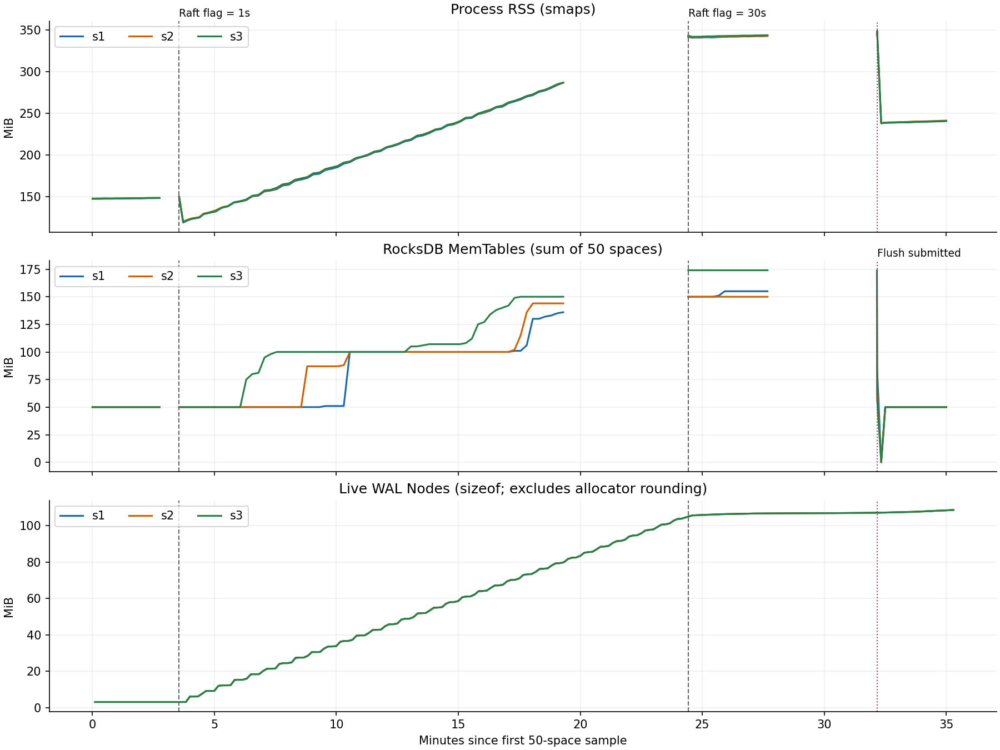

# 为什么没有业务写入，50 个图空间的内存仍会增加？

分析对象：Nebula Graph `3.6-memory`，源码基线提交 `de9b3ed800a6627d9845e9289b6bbc5b6faf460a`。本文按 [可读性与证据规范](../../nebula_graph_readable_analysis_prompts.md) 重写，使用 2026-10-10 已完成的实验，没有把推算写成新实测。

## 1. 直接结论

在本次版本和配置下，业务不写数据时，分片仍会定期写入内部空日志。这些日志既占用每个副本的日志缓存，又使底层数据库反复记录“已经处理到哪里”，两部分内存都会增长。3 个 storage、50 个空空间的加速实验已验证这条因果链：约 15 分钟内，每台进程内存增加约 157MiB。增长主要发生在缓存尚未填满的阶段，不能直接定性为无限泄漏，也不能把这个加速数值当作生产日增量。

本报告先解释空闲场景。另一独立任务“同样 50 个空间，持续写入新数据会怎样”，见 [持续写入与空闲场景对比](WRITE-VS-IDLE.md)。完整实验时间、精确数值、失败记录与重跑命令已移到 [实验明细](EXPERIMENT-DETAILS.md)，原始证据没有删除。

另一个任务的缓存组件对照还显示：停止业务写入后，空日志继续替换缓存内容，缓存实际分配量仍可能上升；这项结论有明确条件，不能直接推成整个 storage 的 RSS 变化，详见上述对比文档。

## 2. 先补齐两个必要背景

**一个业务分片有多个副本，每个副本都会保存日志。** 本次配置是 50 个空间，每个空间 20 个分片，每个分片有 3 个副本，运行在 3 个 storage 进程上。总计 1000 个业务分片、3000 个副本；每台 storage 各有这 1000 个分片的一份副本。因此讨论单台内存时，应计算 1000 份缓存。Leader 是负责发起复制的主副本，Follower 是接收复制的其他副本；Follower 也消耗这部分内存。

**一条内部日志会经过两处不同的内存。** 第一处是 Raft WAL 缓存：Raft 是分片副本之间保持日志一致的机制，WAL 是保存在磁盘上的日志，缓存则是在内存中保留最近一段日志，便于后续读取。第二处是 RocksDB 的 MemTable：RocksDB 是这里保存业务数据和系统状态的底层数据库，MemTable 是尚未刷入数据文件的内存写入区。前者保存“发生过哪些日志”，后者保存“这批日志已经应用到哪里”；它们有不同的内容和回收条件。

下文说“空日志”，指日志的业务内容为空，并非整条记录不存在。它仍有日志序号、任期等信息；任期是 Raft 用来区分不同领导阶段的编号。本文不把 Raft WAL 与 RocksDB 自己的 WAL 混为一谈。

## 3. 为什么会这样：沿着一条空日志看内存如何变化

### 3.1 没有业务请求，主副本仍会主动产生记录

每个分片的主副本会周期检查自己的状态。当它处于正常运行状态，并且当时没有日志复制任务正在进行，就安排追加一条业务内容为空的日志。

这个条件不是“刚选为 Leader 时只做一次”。虽然源码注释提到了新任期的提交需求，但实际判断只有“当前是否正在复制”。所以稳定任期内，只要持续满足条件，也会反复追加空日志。

还需要区分两个动作：这个函数既安排空日志追加，也发送普通的心跳消息。前者会进入 WAL；不能把所有心跳网络消息都当成一条 WAL。复制正在进行时，空日志追加可能被跳过，因此实际速率必须用记录数验证。

### 3.2 空日志成功写盘后，也被留在每个副本的内存里

主副本将记录写到自己的 WAL，再复制给其他副本。其他副本接收到需要追加的记录后，也写入自己的 WAL。共同的写盘路径在成功追加之后，会把记录放入内存缓存；没有“业务内容为空就不缓存”的判断。

缓存按每组 64 条记录分配一个对象，代码里叫 `Node`。这里的 Node 是一组日志记录的内存对象，不是图中的点，也不是一台服务器。第 1 条记录就需要申请一组；第 2～64 条继续使用这组；第 65 条再申请下一组。

因此内存并非每次心跳都增加同样大小，而是随着一组组对象分配，形成台阶。1000 个副本各自跨过这些台阶后，单个分片很小的增长就会累计成明显的进程增长。

### 3.3 “已经处理完”不会立即清空日志缓存

这份缓存的策略是保留最近一段记录。记录应用完成，只意味着业务状态或提交进度已经更新，并不意味着这条记录立刻从缓存删除。

默认容量是每个副本 8MiB，但这里使用的是代码自定义的“逻辑大小”。空记录只算两个 8 字节字段，合计 16 字节；实际 C++ 对象还包括字符串对象、指针和结构开销。因此“逻辑容量 8MiB”不等于“实际只占 8MiB 内存”。

在尚未达到这个逻辑容量时，正常追加路径不会因为记录已经提交、空间闲置很久，就删除这些仍然有效的缓存对象。磁盘 WAL 的保留时间参数 `wal_ttl` 也没有控制这些内存对象的寿命；它处理的是磁盘文件。

### 3.4 空日志没有业务修改，仍要保存“处理到哪条日志”

副本应用日志时，遇到空内容会跳过业务操作。可是它在跳过之前，已经记下该日志的序号和任期。整批日志处理完后，仍然会把最后的序号、任期写到 RocksDB 的系统键中。这个记录就是“提交位点”，表示该分片已经应用到了哪里。

同一个分片反复更新的是同一个系统键，逻辑上只有一份最新进度。但本次使用的 RocksDB 写入路径会把更新加入 MemTable，并不会每次都在一个固定的 16 字节内存位置上覆盖。旧版本、记录结构和内存分配空间会随写入积累，直到刷盘等生命周期变化发生。

所以“业务点边数量没有增加”“系统键数量也没有增加”，都不能推出“MemTable 没有新增写入”。另外，进度是在一批日志结束时写入，并非源码保证每条日志都独立提交一次；实验中两类记录增量接近，是本次负载下的观察。

### 3.5 为什么会长时间上涨，又为什么未必无限上涨

对于空日志，单个 8MiB 逻辑缓存能容纳约 52 万条。以本次配置模板的心跳参数 30 秒计算，基础轮询等待平均约 10.25 秒，实际间隔还会包含执行和排队时间。在复制顺利、没有重置等条件下，按这个节奏从空缓存填到容量大约需要 62 天。容量填得很慢，足以让“正常填充阶段”表现为连续很多天上涨。

达到容量附近后，代码会把较老的一组记录标为待删除。随后，读取缓存的迭代器释放引用，在回收条件满足时批量删除这些旧对象。迭代器就是用来逐条读日志的对象；它尚在使用的内存不能直接删掉。正常读者生命周期下，原始代码组件实验确实出现了内存对象数的平台。

这个平台不是所有情况都能保证的硬上限：新分组会先分配再返回，淘汰按整组进行，物理删除还依赖读者释放。如果读者长期持有引用，已标删对象可以堆积。那是另一种需要单独取证的现象；本次服务增长期间没有看到这种堆积，看到的是有效缓存仍在填充。

## 4. 一个最小例子：只看一个分片的前 65 条空日志

以下是为理解代码设置的假设例子：一个空空间只有 1 个分片，3 个副本分别位于 s1、s2、s3；s1 是稳定主副本，复制正常，没有业务请求，并且每条空日志都单独成功提交。对象大小沿用本机构建的测量结果，不能直接推广到其他编译环境。

操作前，三个副本的日志缓存都是空的。s1 追加第 1 条空日志后，三台最终各保存一条记录，各申请一个可放 64 条记录的 Node；三台也各更新一次提交位点。

接着，第 2～64 条空日志进入已经申请好的 Node。业务点边仍为 0，但缓存中的记录数和 RocksDB 收到的进度更新次数都增加了。第 65 条到来时，原来的 Node 已满，三台各申请第 2 个 Node。

| 每个副本已经收到的空日志数 | 业务点边变化 | 有效 Node 数 | 缓存逻辑计账 | Node 对象大小合计 |
|---:|---|---:|---:|---:|
| 0 | 无 | 0 | 0B | 0B |
| 1 | 无 | 1 | 16B | 3200B |
| 64 | 无 | 1 | 1024B | 3200B |
| 65 | 无 | 2 | 1040B | 6400B |

为什么第 65 条之后没有删除第 1 组？因为此时逻辑计账只有 1040B，离 8MiB 容量还很远。即使这 65 条都已经应用完成，第 1 组仍属于有效缓存。

本机内存分配器为每个 3200B 对象提供的实际分配档位是 3584B，满组折合约 56B/条。这个数描述 Node 分配，不是每条空日志固定增加的进程驻留内存。RocksDB 的新增分配又是另一部分，不能用上表代替它。

回到真实场景：每台有 1000 个这样的副本，同时发生同类增长；这就是没有业务数据也能累积数百 MiB 的数量基础。

## 5. 关键源码怎样支持上述解释

本节源码均核对自上面的固定提交。工作区 `AtomicLogBuffer.cpp` 另有 124 行观测新增，因此下列链接使用固定提交的原始行号，避免把观测代码插入后的行号误当成原始位置。完整调用关系和边界分支见 [Raft 解读](CODE-WALKTHROUGH-RAFT.md)、[WAL 解读](CODE-WALKTHROUGH-WAL.md)、[RocksDB 解读](CODE-WALKTHROUGH-ROCKSDB.md)。

### 5.1 空闲主副本会重复安排空日志

位置：`src/kvstore/raftex/RaftPart.cpp` 的 [needToSendHeartbeat](https://github.com/cccxgit/nebula/blob/de9b3ed800a6627d9845e9289b6bbc5b6faf460a/src/kvstore/raftex/RaftPart.cpp#L1138)、[statusPolling](https://github.com/cccxgit/nebula/blob/de9b3ed800a6627d9845e9289b6bbc5b6faf460a/src/kvstore/raftex/RaftPart.cpp#L1401)、[sendHeartbeat](https://github.com/cccxgit/nebula/blob/de9b3ed800a6627d9845e9289b6bbc5b6faf460a/src/kvstore/raftex/RaftPart.cpp#L2041)。

关键原始条件与动作如下；片段之间省略了锁、选举处理和普通心跳消息发送：

```cpp
// needToSendHeartbeat()
return status_ == Status::RUNNING && role_ == Role::LEADER;

// statusPolling()：下一轮等待时间，另有选举等分支
size_t delay = FLAGS_raft_heartbeat_interval_secs * 1000 / 3
             + folly::Random::rand32(500);

// sendHeartbeat()：追加空日志的完整判断
if (!replicatingLogs_.load(std::memory_order_acquire)) {
  folly::via(executor_.get(), [this] {
    std::string log = "";
    appendLogAsync(clusterId_, LogType::NORMAL, std::move(log));
  });
}
```

它证明：正常主副本具备周期执行入口，且空日志判断没有“仅本任期首次”的限制。它不能证明每次轮询必定成功追加，或所有生产实例都采用 30 秒参数；选举、复制占用、排队和错误都可能改变实际节奏。

### 5.2 主副本和其他副本都把记录放入 WAL 缓存

位置：`src/kvstore/raftex/RaftPart.cpp` 的 [appendLogsInternal](https://github.com/cccxgit/nebula/blob/de9b3ed800a6627d9845e9289b6bbc5b6faf460a/src/kvstore/raftex/RaftPart.cpp#L874) 与 [processAppendLogRequest](https://github.com/cccxgit/nebula/blob/de9b3ed800a6627d9845e9289b6bbc5b6faf460a/src/kvstore/raftex/RaftPart.cpp#L1757)，两者在各自成功路径调用 `wal_->appendLogs(...)`。随后进入 `src/kvstore/wal/FileBasedWal.cpp` 的 [appendLogInternal](https://github.com/cccxgit/nebula/blob/de9b3ed800a6627d9845e9289b6bbc5b6faf460a/src/kvstore/wal/FileBasedWal.cpp#L442)。

后者在校验通过、成功写盘并更新文件信息后，结尾是：

```cpp
logBuffer_->push(id, term, cluster, msg);
return true;
```

它证明：这条成功追加路径没有根据 `msg` 是否为空而跳过缓存，Follower 也有这条路径。它不能证明任意时刻三个副本记录数完全相同；网络复制、提交进度和逐进程采样都有先后。

### 5.3 8MiB 是逻辑计账，释放又分为“标删”和“真正删除”

位置：`src/kvstore/wal/AtomicLogBuffer.h` 的 [Record::size 与 Node](https://github.com/cccxgit/nebula/blob/de9b3ed800a6627d9845e9289b6bbc5b6faf460a/src/kvstore/wal/AtomicLogBuffer.h#L18)，以及 `src/kvstore/wal/AtomicLogBuffer.cpp` 的 [push](https://github.com/cccxgit/nebula/blob/de9b3ed800a6627d9845e9289b6bbc5b6faf460a/src/kvstore/wal/AtomicLogBuffer.cpp#L71) 和 [releaseRef](https://github.com/cccxgit/nebula/blob/de9b3ed800a6627d9845e9289b6bbc5b6faf460a/src/kvstore/wal/AtomicLogBuffer.cpp#L167)。

实际计账代码：

```cpp
constexpr int32_t kMaxLength = 64;

int32_t size() const {
  return sizeof(ClusterID) + sizeof(TermID) + msg_.size();
}
```

下面是按已核实实现整理的**伪代码**，保留影响回收结论的分支：

```text
追加记录：
  如果当前组不存在、已满或已经标删：
    申请新组，放入记录，增加逻辑大小，然后返回
  否则：
    如果追加后超过容量，而且最老组不是当前写入组：
      标记最老组待删除，并从有效逻辑大小中扣除它
    将新记录放入当前组

迭代器释放引用：
  如果这次释放前还有多个读者：返回
  如果待删除组数 > 5，或有效逻辑大小 > 16MiB：
    在没有其他回收任务执行时，真正删除已经标删的旧组
```

它证明：未到容量的有效对象不会因读者释放而被删除；回收有计账、标删、读者释放等明确条件。它也说明容量不是严格的实际堆字节上限。它不能证明现场一定有读者长期不释放；本次需要用对象计数和释放计数区分这两种情况。

### 5.4 “跳过空内容”之后，仍有一次进度写入

位置：`src/kvstore/Part.cpp` 的 [commitLogs](https://github.com/cccxgit/nebula/blob/de9b3ed800a6627d9845e9289b6bbc5b6faf460a/src/kvstore/Part.cpp#L215)、[putCommitMsg](https://github.com/cccxgit/nebula/blob/de9b3ed800a6627d9845e9289b6bbc5b6faf460a/src/kvstore/Part.cpp#L403)，以及 `src/kvstore/RocksEngine.cpp` 的 [commitBatchWrite](https://github.com/cccxgit/nebula/blob/de9b3ed800a6627d9845e9289b6bbc5b6faf460a/src/kvstore/RocksEngine.cpp#L124)。

实际循环的关键部分：

```cpp
while (iter->valid()) {
  lastId = iter->logId();
  lastTerm = iter->logTerm();
  auto log = iter->logMsg();
  if (log.empty()) {
    VLOG(4) << idStr_ << "Skip the heartbeat!";
    ++(*iter);
    continue;
  }
  // ... 省略非空日志的业务操作处理与循环推进
}
```

循环之后，如果 `lastId >= 0`，代码调用 `putCommitMsg(batch.get(), lastId, lastTerm)`；失败时返回错误，成功后继续提交整个 batch。该函数向 `systemCommitKey(partId_)` 写入序号和任期，而 `commitBatchWrite` 最终调用 `db_->Write(...)`。

它证明：空内容只跳过业务修改，没有跳过最后的系统进度写入。它不能仅凭这段 Nebula 代码给出一次写入会占多少 RocksDB 内存；这部分由独立组件实验、实际 OPTIONS 配置和服务 MemTable 指标补充验证。

### 5.5 磁盘 TTL 和内存清理做的是不同事情

位置：`src/kvstore/wal/FileBasedWal.cpp` 的 [cleanWAL](https://github.com/cccxgit/nebula/blob/de9b3ed800a6627d9845e9289b6bbc5b6faf460a/src/kvstore/wal/FileBasedWal.cpp#L640)。关键分支如下，省略日志输出及循环推进：

```cpp
if (index++ < size - 2 && (now - it->second->mtime() > walTTL)) {
  unlink(it->second->path());
  it = walFiles_.erase(it);
  count++;
}
```

它证明：这条 TTL 清理按文件年龄删除磁盘文件，并且保留最近两个文件；这里没有删除有效缓存对象或调用缓存重置。它不能证明任何文件满 4 小时就一定消失，也不能把磁盘占用下降当成内存缓存已经释放的证据。

后台内存清理也不代替对象释放。`MemoryUtils::handleMemoryTracker` 会在满足配置等条件时请求内存分配器归还可回收页面，但没有在这里删除 WAL 有效对象或刷盘 MemTable。完整条件和统计口径见 [RocksDB 与内存监控解读](CODE-WALKTHROUGH-ROCKSDB.md)。

## 6. 已有实验怎样支持代码，又有哪些不能推出的结论

### 6.1 实验先保证“真的没有业务写入”

这轮实验运行了 1 个 metad、1 个 graphd 和 3 个独立 storaged，50 个空间各有 20 分片、3 副本。只创建了空间，没有创建点类型、边类型，也没有发出业务增删改命令。检查确认每台有 1000 个本地副本，采样期间没有进程重启。

程序由当前工程构建；用户限制提出后，编译和安装均使用 `make -j5`。启动前设置了 65536 的文件句柄限制。产品源码只增加了开关控制的计数和限频日志，没有改变心跳、缓存、回收或 RocksDB 写入算法；[原始代码组件实验](COMPONENT-ANALYSIS.md) 另外使用未加观测的源码验证缓存行为。

最终停止服务后，逐条检查了 3000 个 WAL 文件，得到 **6,730,574 条日志，业务内容全部为空**，没有发现记录缺口或不完整尾记录。这证明“没有业务数据，仍产生大量实际日志”；结合本次命令记录和源码路径，支持内部心跳的解释。单独看到空内容还不足以判定唯一来源，因为源码也有其他能产生空日志的内部操作。

### 6.2 先慢速观察，再加速，最后恢复慢速

为了缩短等待时间，实验先使用配置模板的 Raft 心跳参数 30 秒，再改为 1 秒，加速观察后恢复 30 秒。参数是调度公式的输入，并不等于空日志的实际间隔；实测追加速率约提高 17.7 倍，不是 30 倍。

以下为三个 storage 各自的结果范围，MiB 使用 1024×1024 字节。进程内存采用系统报告的 RSS，即当时驻留在物理内存中的进程页面；MemTable 来自 RocksDB 属性，Node 来自服务内对象计数，三者不是同一个统计口径。

| 对照阶段 | 实际观察时间 | 每台进程的观察 | 对代码解释的意义 |
|---|---:|---|---|
| 还没有创建目标空间 | 约 50 秒 | RSS 约 55MiB；没有目标分片 WAL | 提供进程基线，不能把此时目标空间缺测当作整个 RocksDB 用量为零 |
| 50 个空空间，心跳参数 30 秒 | 约 165 秒 | 每台新增约 1.6 万条空日志；RSS 增加约 0.7～1.0MiB | 空闲仍有写入；此时 Node 没增加，不能把这一小段 RSS 全归给新 Node |
| 改为 1 秒，过渡后观察 | **885 秒，约 15 分钟** | **每台 RSS 增加约 157～158MiB，59 个相邻采样间隔全部上涨** | 加速内部写入时，可以稳定复现持续增长 |
| 恢复 30 秒，过渡后观察 | 约 165 秒 | 空日志速率降回每台约 100 条/秒；RSS 净增约 1.8～2.0MiB | 写入减慢了，但此前有效缓存不会因此立即消失 |

第一段 30 秒参数实验中，每个副本还在填第一个 64 槽对象，所以每台 Node 总数一直是 1000。这个结果恰好对应最小例子的第 1～64 条：有新日志，不代表每个采样点都有新对象分配。

切换到 1 秒的过渡期出现了约 25MiB 的 RSS 回落，当时 Node 反而增加、也没有释放。这个与主增长窗口不同的现象保留在明细中，没有强行给它指定唯一原因。因此本文说的“持续上涨”严格指过渡后的 885 秒窗口。

### 6.3 加速阶段，两条内存增长路径都有直接证据

只看进程 RSS，无法知道哪种对象变多了。服务内部计数和 RocksDB 属性补上了这一步：

| 指标 | 加速阶段每台的变化 | 可以支持的判断 |
|---|---|---|
| 存活 WAL Node | 从 3000 个增至 26,005 个，没有任何 Node 删除 | WAL 确实在保留更多内存对象，不只是磁盘文件变大 |
| Node 对象大小合计 | 增加约 70.2MiB | 能量化对象本身的增长；还没有计入分配器档位等开销 |
| 50 个目标空间的 MemTable | 三台分别增加 86、94、100MiB | 系统进度写入也在积累，RSS 增长不能全算给 WAL |
| 日志读取对象的引用释放 | 每台发生数百万次 | 这次增长不符合“从来没有读者释放”的解释 |
| 数据块缓存、文件读取对象 | 主窗口内保持不变 | 不支持它们是本轮主要增量来源 |

Node 表使用外部采样窗口内部约 870 秒的日志观察，RSS 与 MemTable 使用 885 秒的外部采样。即使数值量级相近，也不能写成“70.2 + 86 恰好等于 RSS 增量”的会计等式。本机构建每个 Node 的实际分配档位比对象大小大；另一方面，MemTable 申请空间与立即驻留的物理页也不一一对应。

观测到的缓存逻辑大小还远低于容量，采到的单缓存没有待删除对象，整个进程也没有发生 Node 删除；与源码一起看，这轮增长处在有效缓存填充阶段。单缓存字段只是一次观测中的一个对象，不能冒充同一时刻对全部 1000 个缓存的完整快照。



图应结合上面的阶段表阅读。图中 RSS 使用同一原始采样里的 `smaps` 读数，正文数值使用 `VmRSS`；两次读取时刻略有差异。外部采样缺口处已经断线，不能把空白时段当成连续观测。

### 6.4 刷盘对照把 RocksDB 的贡献单独显露出来

恢复慢速后，实验对 50 个空间发出 FLUSH，并核实 50 个作业全部完成。FLUSH 是把 MemTable 中的数据写入磁盘数据文件，让旧 MemTable 能退出使用的操作；本次把它作为诊断对照，没有把它当成产品修复。

| 每台 storage | 刷盘前 RSS | 约 170 秒后的 RSS | RSS 减少 | MemTable 减少 |
|---|---:|---:|---:|---:|
| s1 | 344.6MiB | 240.7MiB | 103.9MiB | 123MiB |
| s2 | 344.6MiB | 241.2MiB | 103.4MiB | 100MiB |
| s3 | 345.5MiB | 240.8MiB | 104.7MiB | 124MiB |

同一观察过程里，三台 WAL Node 都从约 3.51 万个继续增到约 3.55 万个，没有 Node 被删除。也就是说，RSS 大幅回落时，RocksDB MemTable 减少了，WAL 有效缓存没有随之消失。

刷盘后心跳仍在继续，因此新的 MemTable 很快又得到写入。50 个空间的 MemTable 聚合属性从观测谷值约 0.1MiB 回到约 50.1MiB；此时 RSS 只小幅上涨，说明新申请空间可能复用已有页面，不能把 MemTable 属性增加量直接等同 RSS 增加量。

这项对照支持“WAL 缓存和 RocksDB 写入内存都参与了增长”。它不能把刷盘后剩余 RSS 全归给 WAL；进程还有线程、连接、管理存储等对象，也不能把 FLUSH 命令返回时刻当作全部异步作业完成时刻。

### 6.5 原始代码组件实验回答了服务短实验答不了的问题

真实服务运行时间不够长，无法等每个空日志缓存自然填满。为验证容量和释放逻辑，另一个实验直接调用固定提交里的原始缓存实现，快速写入空记录，并正常创建、释放读取对象。

单个缓存写到约 52 万条时，逻辑大小达到约 8MiB，Node 的实际分配量约 28MiB。继续写到 110 万条，Node 数仍在约 8192 个附近小幅变化，说明这个条件下出现了平台。另一个 1000 缓存实验中，每缓存只写 4096 条空记录，就产生约 219MiB 的 Node 分配量，而且尚无待删除对象。

RocksDB 组件实验则只反复覆盖少量系统键：5 个数据库、每库 20 个键，累计一百万次写入后，MemTable 从约 10KiB 增至约 50MiB；主动刷盘后又降回约 10KiB。它直接验证了“键数量固定，内存仍能随版本写入增长”。

这些实验支持两个机制，但不代表生产环境已经达到过相同的平台或吞吐量。组件构造的“长期持有读者”和“不释放读者”实验还能产生待删除对象积累；本次服务并没有证实存在这种异常条件。完整参数与原始记录见 [组件分析](COMPONENT-ANALYSIS.md)。

### 6.6 为什么“每天几百 MiB”在数量上解释得通

下面是条件推算，不是生产实测。假设本地有 1000 个副本、全部处于空闲正常复制状态、缓存还没填满，且平均每 10.25 秒收到一条空日志：

- 每个副本一天约新增 8430 条空日志。
- 按本机构建满组平均约 56B/条的 Node 分配计算，每台一天约新增 **450MiB** 的 WAL Node 分配。
- 从空缓存填到约 52 万条，大约需要 **62 天**；1000 份缓存对应的平台量级约 **27.3GiB**，还没有计入 RocksDB 等内存。

这解释了为什么空闲空间也可能出现“每天增加几百 MiB、持续很久”的现象。不过 27.3GiB 不是安全预算，也不是本次真实服务已经达到的数值；它只是上述条件下的缓存量级，机器可能在达到它之前就受到内存压力影响。

生产实际心跳配置、每台副本数、缓存已经填充多久、是否有业务复制，以及读者和刷盘行为，都会改变曲线。因此本报告能解释问题的机制和量级，尚不能替代生产进程的独立取证。

## 7. 如何在实际环境确认是不是同一问题

优先做以下三项只读检查。这里是建议验证；不把尚未检查的生产条件写成已确认事实。

| 检查什么 | 符合本次解释的观察 | 什么结果需要改变判断 |
|---|---|---|
| 同时记录每台本地副本数、实际心跳参数、空日志追加速率 | 无业务时仍有持续空日志，速率随实际调度条件变化 | 没有空日志增量，却仍有大幅增长，说明要优先寻找其他对象 |
| 同一时间窗口观察 WAL 存活对象、删除次数和读者引用 | 有效对象增加、未到容量，符合缓存填充 | 已经达到容量且待删除对象持续堆积，应改查读者生命周期或回收条件；对象数不变则不能把新增 RSS 都归给 Node |
| 同时采集目标空间 MemTable 和进程 RSS | MemTable 随内部进度写入增长；自然刷盘时能够回落 | MemTable 不变但 RSS 大涨，要检查其他对象、页面触碰或分配器；不能仅凭 RSS 反推 MemTable 泄漏 |

若要重复 FLUSH 对照或加速实验，应在独立测试环境执行 [实验明细中的命令](EXPERIMENT-DETAILS.md)。加速会改变内部写入压力，FLUSH 会引入磁盘 I/O；现有证据复查则可以完全不启动服务，直接解析已归档的 WAL 与采样数据。

本次实验的进程持续存活到主动停止，没有用请求被 MemoryTracker 拒绝或容器 OOM 事件来解释曲线；现有证据也不足以建立这些事件在生产环境中的先后关系。MemoryTracker 是内存跟踪与保护机制，OOM 是操作系统因内存不足终止进程，两者不能仅凭“内存上涨”混为一谈。

原有两次失败采样、心跳切换过渡、07:23～07:28 的外部采样缺口、任期变化范围和非原子采样边界，全部保留在 [实验明细](EXPERIMENT-DETAILS.md)。主文只对有效窗口给出定量结论。

## 8. 最终结论

在当前版本里，空闲业务空间仍会产生内部空日志；这些记录既逐渐填充每个副本的 WAL 缓存，又通过提交位点更新增加 RocksDB 写入内存。源码、原始代码组件实验、三实例持续增长和 FLUSH 对照相互支持，确认了本次复现的两条主要增长路径。

本次证据支持“填充阶段可以很长、实际开销大于逻辑容量”，不支持直接宣称无限泄漏、所有增长都来自 WAL，或生产 RSS 必然每天增加固定数值。生产验证最有价值的是同一时窗里的空日志速率、WAL 对象及回收计数、MemTable 和 RSS，而不是单独观察业务数据量。
